# BUSINESS REQUIREMENTS DOCUMENT (BRD)
# APLIKASI BACATEPAT
**Aplikasi Pembelajaran Membaca Permulaan untuk Siswa SD Kelas 1–3**

| Item | Keterangan |
|---|---|
| Versi | 2.0 (hasil audit dan perbaikan) |
| Tanggal | 15 November 2026 |
| Status | Rancangan sistem. Belum ada aplikasi yang dikembangkan |
| Teknologi | Flutter (frontend), Laravel (backend), MySQL (database) |

## Riwayat Perubahan Dokumen

| Versi | Tanggal | Perubahan |
|---|---|---|
| 1.0 | – | Penyusunan awal dokumen |
| 2.0 | 15 Nov 2026 | Audit 12 poin. Penambahan tabel pendukung (detail jawaban, set tes, rekomendasi, log AI), persetujuan wali pada data siswa, penegasan alur AI, perbaikan diagram dan konsistensi ID |

## Daftar Isi

1. Pendahuluan
2. Gambaran Umum Proyek
3. Tujuan dan Sasaran
4. Ruang Lingkup
5. Stakeholder dan Pengguna
6. Teknologi yang Digunakan
7. Gambaran Sistem
8. Kebutuhan Bisnis
9. Kebutuhan Fungsional
10. Kebutuhan Nonfungsional
11. Deskripsi Fitur
12. Business Rules
13. Use Case
14. Activity Diagram
15. Sequence Diagram
16. Rancangan Database
17. Rancangan API
18. Rancangan Antarmuka
19. Alur Bisnis End-to-End
20. Dashboard dan Laporan
21. Testing dan Acceptance Criteria
22. Risiko dan Mitigasi
23. Scope dan Batasan
24. Roadmap Pengembangan
25. Kesimpulan
26. Lampiran

> Catatan penomoran: struktur 30 bagian pada prompt asli digabung menjadi 26 bab agar tidak ada bab kosong (Halaman Judul, Informasi Dokumen, Riwayat Perubahan, dan Daftar Isi sudah berada di awal dokumen).

---

# 1. Pendahuluan

## 1.1 Tujuan Dokumen
Dokumen ini menjadi pedoman pengembangan aplikasi BacaTepat bagi tim developer. Dokumen memuat kebutuhan bisnis, kebutuhan fungsional dan nonfungsional, rancangan database, API, antarmuka, pengujian, risiko, dan roadmap.

## 1.2 Status Dokumen
Seluruh isi adalah **rancangan sistem yang akan dikembangkan**. Tidak ada bagian yang menyatakan aplikasi sudah berjalan atau integrasi AI sudah selesai.

## 1.3 Istilah Penting

| Istilah | Arti |
|---|---|
| Diagnostik | Tes awal untuk mengetahui kemampuan membaca siswa |
| Aspek | Empat tingkatan membaca: huruf, suku kata, kata, kalimat |
| Rule-based | Keputusan berdasarkan aturan angka yang tetap, bukan AI |
| Speech-to-text (STT) | Layanan yang mengubah suara menjadi teks |
| Transkrip | Teks hasil STT |
| REST API | Cara Flutter dan Laravel bertukar data lewat HTTP dan JSON |
| Sanctum | Paket Laravel untuk token autentikasi API |
| Private storage | Penyimpanan file yang tidak dapat diakses lewat URL publik |
| Retensi | Lama data disimpan sebelum dihapus |

# 2. Gambaran Umum Proyek

## 2.1 Latar Belakang
Kemampuan membaca adalah keterampilan dasar siswa SD. Kemampuan tiap siswa berbeda. Sebagian sudah membaca kalimat sederhana, sebagian masih kesulitan mengenali huruf atau menggabungkan suku kata. Guru membutuhkan sarana untuk mengidentifikasi kemampuan setiap siswa, memberi latihan sesuai kesulitan, dan memantau perkembangan secara terstruktur.

## 2.2 Deskripsi Aplikasi
BacaTepat adalah aplikasi pembelajaran membaca permulaan berbasis digital untuk siswa SD kelas 1–3. Tiga fitur utamanya:

1. **Reading Diagnostic**: tes untuk mengetahui kemampuan awal.
2. **Adaptive Reading Practice**: latihan yang menyesuaikan hasil diagnostik dan hasil latihan.
3. **Teacher Audio Review**: siswa merekam suara saat membaca, Guru mengevaluasi.

## 2.3 Asumsi Perancangan

| ID | Asumsi | Alasan |
|---|---|---|
| AP-01 | Akun Guru dibuat lewat seeder atau perintah artisan oleh pengembang atau pihak sekolah. Tidak ada pendaftaran publik | Tidak ada role Admin, sehingga pembuatan akun Guru pertama harus dilakukan di luar aplikasi |
| AP-02 | Guru kedua dan seterusnya dapat dibuat dengan perintah artisan yang sama | Menjaga dua role tanpa fitur admin |
| AP-03 | Satu kelas dikelola satu Guru. Satu Guru dapat mengelola banyak kelas | Sesuai kebutuhan "Guru dapat mengelola beberapa kelas" |
| AP-04 | Siswa login memakai username dan password, bukan email | Siswa kelas 1–3 umumnya belum punya email |
| AP-05 | Perekaman dan analisis AI hanya aktif jika wali siswa menyetujui, dan persetujuan dicatat Guru | Audio suara anak adalah data pribadi anak |
| AP-06 | Bahasa antarmuka dan materi adalah Bahasa Indonesia | Fokus membaca permulaan |
| AP-07 | Aplikasi membutuhkan internet. Mode offline di luar MVP | Penilaian, rekaman, dan sinkronisasi dilakukan di server |
| AP-08 | Platform MVP adalah Android. iOS dan web adalah pengembangan lanjutan | Kemampuan Flutter mendukung ekspansi tanpa mengubah backend |
| AP-09 | Retensi rekaman audio 90 hari setelah dievaluasi, dapat diubah Guru sampai 180 hari | Meminimalkan data anak yang disimpan |

# 3. Tujuan dan Sasaran

## 3.1 Tujuan

| ID | Tujuan | Indikator keberhasilan |
|---|---|---|
| T1 | Membantu Guru mengidentifikasi tingkat kemampuan membaca siswa | Hasil diagnostik tersimpan untuk 100% siswa yang menyelesaikan tes |
| T2 | Mengetahui aspek yang masih sulit | Setiap siswa memiliki status penguasaan untuk 4 aspek |
| T3 | Menyediakan latihan sesuai hasil diagnostik | Setiap siswa yang telah didiagnostik memiliki rekomendasi aktif |
| T4 | Siswa berlatih mandiri | Siswa dapat menyelesaikan latihan tanpa bantuan teknis Guru |
| T5 | Siswa mengirim rekaman suara | Rekaman berhasil terkirim dan tersimpan privat |
| T6 | Guru mengevaluasi ketepatan dan kelancaran | Setiap rekaman dapat dinilai Guru |
| T7 | Menyediakan informasi perkembangan | Grafik per aspek tersedia untuk Guru dan Siswa |
| T8 | Memanfaatkan AI dengan kendali Guru | Tidak ada keluaran AI yang berlaku tanpa persetujuan atau penilaian Guru |

## 3.2 Sasaran Terukur (usulan)
- Guru menyelesaikan pembuatan satu soal dengan bantuan AI dan review dalam kurang dari 3 menit.
- Penilaian satu rekaman oleh Guru selesai dalam kurang dari 2 menit.
- Seluruh halaman siswa dapat dipakai dengan ketukan tanpa mengetik, kecuali login.

# 4. Ruang Lingkup

Ruang lingkup lengkap berada pada Bab 23. Ringkasnya, MVP mencakup pengelolaan siswa dan kelas, diagnostik, latihan adaptif rule-based, rekaman suara, evaluasi Guru, bantuan AI (pembuatan materi dan soal, transkripsi), grafik, dan laporan PDF.

# 5. Stakeholder dan Pengguna

## 5.1 Role Pengguna
**Hanya dua role: Guru dan Siswa.** Tidak ada role Admin. Wali murid **bukan role** dan tidak memiliki akun. Persetujuan wali hanya dicatat oleh Guru sebagai data pada profil siswa.

| Hak akses | Guru | Siswa |
|---|---|---|
| Login, logout, ubah password sendiri | Ya | Ya (ubah password: tidak, direset Guru) |
| Kelola profil sendiri | Ya | Hanya lihat |
| Kelola siswa dan kelas | Ya (miliknya) | Tidak |
| Kelola materi dan soal | Ya | Tidak |
| Gunakan generator AI | Ya | Tidak |
| Buat dan aktifkan tes diagnostik | Ya | Tidak |
| Kerjakan diagnostik dan latihan | Tidak | Ya |
| Rekam dan kirim suara | Tidak | Ya |
| Dengar rekaman dan beri evaluasi | Ya (siswa di kelasnya) | Tidak |
| Lihat hasil evaluasi | Ya | Hanya miliknya |
| Lihat grafik dan laporan | Ya (siswa di kelasnya) | Grafik miliknya |
| Ubah rekomendasi latihan | Ya | Tidak |

## 5.2 Pemangku Kepentingan Lain
Sekolah dan wali siswa menjadi pihak berkepentingan tetapi tidak menjadi aktor sistem.

# 6. Teknologi yang Digunakan

| Komponen | Teknologi | Fungsi | Alasan |
|---|---|---|---|
| Frontend | Flutter | Antarmuka Guru dan Siswa, perekaman audio, grafik | Satu basis kode untuk Android dan iOS, mendukung perekaman audio |
| Backend | Laravel | REST API, logika bisnis, antrean (queue), scheduler, pembuatan PDF | Ekosistem lengkap untuk auth, validasi, policy, storage, queue |
| Database | MySQL 8 | Data relasional dan metadata audio | Relasional, mendukung FK dan indeks, sesuai kebutuhan data terstruktur |
| Komunikasi | REST API (JSON, HTTPS) | Pertukaran data client-server | Sederhana dan dapat diuji |
| Autentikasi | Laravel Sanctum (token) | Login API Flutter | Cocok untuk aplikasi mobile |
| Penyimpanan audio | Laravel Private Storage (`storage/app/private`) | Menyimpan file rekaman | Tidak dapat diakses lewat URL publik |
| AI | OpenAI API atau layanan kompatibel | Pembuatan materi dan soal, STT, narasi saran | Dipanggil hanya dari backend |
| Grafik | Library chart Flutter (contoh: `fl_chart`) | Visualisasi perkembangan | Matang dan mudah dipakai |
| Antrean | Laravel Queue (driver `database`) | Pemrosesan AI di latar belakang | Tidak membutuhkan Redis pada MVP |

## 6.1 Arsitektur Komunikasi
Flutter hanya berbicara dengan Laravel. Laravel berbicara dengan MySQL, Private Storage, dan AI API. Flutter tidak pernah memegang API key AI dan tidak pernah berhubungan langsung dengan AI maupun database.

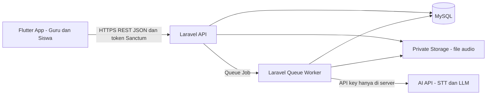

Penjelasan: aplikasi Flutter mengirim permintaan HTTPS ke Laravel dengan token. Pekerjaan berat dan berbiaya (AI) dijalankan oleh queue worker agar permintaan pengguna tidak menunggu. Worker membaca audio dari storage privat dan menulis hasil ke MySQL.

## 6.2 Keterbatasan Speech-to-Text untuk Anak
- Pelafalan anak usia 6–9 tahun, kosakata sederhana, dan huruf yang dibaca terpisah (misalnya "ba", "bi") sering salah dikenali STT.
- Huruf tunggal dan suku kata sangat pendek hampir tidak dapat ditranskripsi dengan andal.
- Kebisingan kelas dan kualitas mikrofon ponsel memengaruhi hasil.
- Karena itu transkrip hanya **indikasi pendukung**. Analisis suara dibatasi pada **kata dan kalimat**. Untuk aspek huruf dan suku kata, Guru menilai langsung dengan mendengarkan.
- Hasil AI tidak dinyatakan sebagai penilaian ilmiah atau diagnosis kemampuan membaca maupun gangguan belajar.

# 7. Gambaran Sistem

## 7.1 Pembagian Proses

| Dikerjakan sistem biasa (Laravel) | Dikerjakan AI | Membutuhkan keputusan Guru |
|---|---|---|
| Login, hak akses, CRUD data | Draf materi dan soal | Menyetujui, mengedit, atau menolak soal dan materi AI |
| Penilaian soal pilihan ganda | Transkripsi rekaman (STT) | Nilai ketepatan dan kelancaran |
| Perhitungan skor aspek dan status penguasaan | Narasi saran (opsional, dari angka yang sudah dihitung sistem) | Komentar dan saran akhir |
| Rekomendasi latihan (rule-based) | – | Mengubah rekomendasi, memutuskan pendampingan |
| Perbandingan transkrip dengan teks target (algoritma PHP, bukan LLM) | – | Menilai soal baca lisan pada diagnostik |
| Grafik, laporan, retensi data | – | Mencatat persetujuan wali |

## 7.2 Prinsip Rancangan
1. Rule-based adalah mekanisme utama rekomendasi. AI hanya tambahan.
2. AI tidak membaca database. Backend memilih data minimum, menghapus identitas, lalu mengirimkannya.
3. Nilai AI tidak pernah masuk ke tabel nilai resmi. Nilai resmi hanya berasal dari soal otomatis dan evaluasi Guru.
4. Audio berada di storage privat dan diakses lewat endpoint yang melakukan pengecekan hak akses.
# 8. Kebutuhan Bisnis

| ID | Nama | Deskripsi | Tujuan | Prioritas | Kriteria keberhasilan |
|---|---|---|---|---|---|
| BR-001 | Identifikasi kemampuan membaca | Sistem menyediakan tes diagnostik untuk 4 aspek membaca | T1, T2 | High | Hasil per aspek tersimpan untuk setiap siswa yang menyelesaikan tes |
| BR-002 | Latihan berdasarkan hasil | Sistem merekomendasikan latihan dari hasil diagnostik dan latihan | T3, T4 | High | Setiap siswa dengan status "belum dikuasai" memiliki rekomendasi aktif |
| BR-003 | Pengiriman rekaman suara | Siswa dapat merekam, mendengar ulang, dan mengirim rekaman | T5 | High | Rekaman terkirim dan tersimpan privat dengan metadata lengkap |
| BR-004 | Evaluasi oleh Guru | Guru menilai ketepatan, kelancaran, dan memberi komentar | T6 | High | Setiap rekaman dapat dinilai dan hasilnya terbaca siswa |
| BR-005 | Pemantauan perkembangan | Guru dan Siswa melihat grafik dan riwayat | T7 | High | Grafik per aspek tampil dari data riwayat |
| BR-006 | Bantuan AI terkendali | AI membantu membuat materi, soal, dan transkripsi tanpa menggantikan Guru | T8 | Medium | Semua keluaran AI berstatus draf sampai Guru menyetujui. Nilai akhir selalu dari Guru |
| BR-007 | Pengelolaan siswa dan kelas | Guru membuat akun siswa dan mengelompokkan ke kelas | T1 | High | Guru dapat membuat akun siswa dan menempatkannya ke kelas |
| BR-008 | Perlindungan data anak | Data siswa dan audio dilindungi, ada persetujuan wali dan retensi | T5, T8 | High | Tidak ada akses antar siswa. Audio hanya diakses lewat endpoint terautorisasi. Audio terhapus sesuai retensi |
| BR-009 | Laporan hasil belajar | Guru membuat laporan yang dapat dicetak atau diekspor | T7 | Medium | PDF laporan siswa dan kelas dapat diunduh |
| BR-010 | Pendampingan siswa | Sistem menandai siswa yang perlu pendampingan Guru | T2, T7 | Medium | Daftar siswa perlu pendampingan tampil di dashboard Guru |

# 9. Kebutuhan Fungsional

Format ringkas: setiap baris memuat ID, nama, aktor, input, proses, output, validasi, kondisi berhasil dan gagal, serta prioritas. Deskripsi fungsi dirangkum pada kolom Nama dan Proses.

## 9.1 FR-AUTH

| ID | Nama | Aktor | Input | Proses | Output | Validasi | Berhasil / Gagal | Prioritas |
|---|---|---|---|---|---|---|---|---|
| FR-AUTH-01 | Login | Guru, Siswa | username, password, device_name | Cek kredensial dan akun aktif, buat token Sanctum, catat `last_login_at` | Token, data user (id, nama, role) | username wajib, password min 8 | Berhasil: token terbit. Gagal: 422 untuk input kosong, 401 untuk kredensial salah, 403 jika akun nonaktif. Pembatasan 5 percobaan per menit per username (429) | High |
| FR-AUTH-02 | Logout | Guru, Siswa | token | Hapus token aktif | Pesan sukses | Token valid | Berhasil: token tidak berlaku lagi | High |
| FR-AUTH-03 | Ambil profil login | Guru, Siswa | token | Ambil data user dan profil siswa jika siswa | Data profil | – | Gagal: 401 | High |
| FR-AUTH-04 | Ganti password | Guru | password_lama, password_baru | Verifikasi lama, hash bcrypt, cabut token lain | Pesan sukses | Baru min 8 karakter, beda dengan lama | Gagal: 422 | Medium |

## 9.2 FR-GURU dan FR-SISWA

| ID | Nama | Aktor | Input | Proses | Output | Validasi | Berhasil / Gagal | Prioritas |
|---|---|---|---|---|---|---|---|---|
| FR-GURU-01 | Dashboard Guru | Guru | – | Agregasi jumlah siswa, kelas, status diagnostik, antrean rekaman, siswa perlu pendampingan | Ringkasan dashboard | Hanya data milik Guru | Gagal: 401/403 | High |
| FR-GURU-02 | Ubah profil Guru | Guru | nama, email | Simpan perubahan | Profil terbaru | email format valid dan unik | Gagal: 422 | Low |
| FR-SISWA-01 | Beranda Siswa | Siswa | – | Ambil rekomendasi aktif, aktivitas terbaru, hasil evaluasi terbaru | Data beranda | Hanya data milik sendiri | Gagal: 401/403 | High |
| FR-SISWA-02 | Lihat profil sendiri | Siswa | – | Ambil profil | nama, kelas | Hanya milik sendiri | – | Low |

## 9.3 FR-STUDENT

| ID | Nama | Aktor | Input | Proses | Output | Validasi | Berhasil / Gagal | Prioritas |
|---|---|---|---|---|---|---|---|---|
| FR-STUDENT-01 | Tambah siswa | Guru | nama, username, password awal, kelas_id, nama_wali, tanggal_lahir (opsional) | Buat `users` (role siswa) dan `siswa` dalam satu transaksi | Data siswa | username unik, kelas milik Guru, password min 8 | Gagal: 422, transaksi dibatalkan jika salah satu gagal | High |
| FR-STUDENT-02 | Ubah data siswa | Guru | data siswa | Perbarui `users` dan `siswa` | Data terbaru | Siswa berada di kelas milik Guru | Gagal: 403/404 | High |
| FR-STUDENT-03 | Nonaktifkan siswa | Guru | siswa_id | Set `users.aktif = 0`, cabut token | Pesan sukses | – | Data riwayat tidak dihapus | Medium |
| FR-STUDENT-04 | Daftar dan cari siswa | Guru | kelas_id, kata kunci, halaman | Query terpaginasi | Daftar siswa | Hanya siswa kelas milik Guru | – | High |
| FR-STUDENT-05 | Reset password siswa | Guru | siswa_id, password_baru | Hash dan cabut token siswa | Pesan sukses | Min 8 karakter | Gagal: 403 | Medium |
| FR-STUDENT-06 | Catat persetujuan wali | Guru | siswa_id, persetujuan_wali, persetujuan_ai | Simpan nilai dan waktu persetujuan | Status persetujuan | Boolean. Waktu terisi otomatis | Tanpa persetujuan_wali, siswa tidak dapat mengirim rekaman. Tanpa persetujuan_ai, rekaman tidak dikirim ke AI | High |

## 9.4 FR-CLASS

| ID | Nama | Aktor | Input | Proses | Output | Validasi | Berhasil / Gagal | Prioritas |
|---|---|---|---|---|---|---|---|---|
| FR-CLASS-01 | Tambah dan ubah kelas | Guru | nama_kelas, tingkat (1–3), tahun_ajaran | Simpan dengan `guru_id` Guru login | Data kelas | Kombinasi guru, nama, tahun ajaran unik | Gagal: 422 | High |
| FR-CLASS-02 | Daftar kelas | Guru | – | Ambil kelas dan jumlah siswa | Daftar kelas | – | – | High |
| FR-CLASS-03 | Pindah kelas siswa | Guru | siswa_id, kelas_id | Ubah `siswa.kelas_id` | Data siswa | Kelas tujuan milik Guru | Gagal: 403 | Medium |
| FR-CLASS-04 | Hapus kelas | Guru | kelas_id | Hapus jika tidak ada siswa | Pesan sukses | Kelas tidak berisi siswa | Gagal: 409 jika masih berisi siswa | Low |

## 9.5 FR-MATERIAL (materi dan bank soal)

| ID | Nama | Aktor | Input | Proses | Output | Validasi | Berhasil / Gagal | Prioritas |
|---|---|---|---|---|---|---|---|---|
| FR-MATERIAL-01 | Kelola materi | Guru | judul, aspek, tingkat_kesulitan (1–3), konten | Simpan, ubah, arsip | Data materi | aspek dalam 4 nilai. Tingkat 1–3. Konten wajib | Gagal: 422 | High |
| FR-MATERIAL-02 | Daftar dan filter materi | Guru | aspek, tingkat, status | Query terpaginasi | Daftar materi | – | – | High |
| FR-MATERIAL-03 | Kelola soal | Guru | aspek, tingkat, tipe, pertanyaan, teks_target, opsi, kunci, penggunaan | Simpan dan ubah soal | Data soal | Pilihan ganda: min 2 opsi dan kunci ada di opsi. Baca lisan: teks_target wajib | Gagal: 422 | High |
| FR-MATERIAL-04 | Review soal atau materi dari AI | Guru | id, aksi (setujui/ubah/tolak) | Ubah status draf menjadi disetujui atau ditolak | Status terbaru | Hanya Guru pemilik | Soal berstatus draf tidak dapat dipakai pada tes maupun latihan | High |

## 9.6 FR-DIAG

| ID | Nama | Aktor | Input | Proses | Output | Validasi | Berhasil / Gagal | Prioritas |
|---|---|---|---|---|---|---|---|---|
| FR-DIAG-01 | Buat tes diagnostik | Guru | judul, kelas_id, daftar soal dan urutan | Simpan tes dan relasi soal | Tes (draf) | Hanya soal berstatus disetujui. Minimal 1 soal per aspek | Gagal: 422 | High |
| FR-DIAG-02 | Aktifkan tes | Guru | tes_id | Ubah status menjadi aktif | Tes aktif | Tes memiliki soal pada 4 aspek | Gagal: 422 | High |
| FR-DIAG-03 | Lihat dan mulai tes | Siswa | – | Cari tes aktif untuk kelas siswa, buat `hasil_diagnostik` berstatus berjalan | Soal tes tanpa kunci jawaban | Siswa belum mengerjakan tes yang sama | Gagal: 409 jika sudah ada hasil | High |
| FR-DIAG-04 | Kirim jawaban | Siswa | hasil_id, daftar jawaban | Simpan ke `jawaban_siswa`, nilai otomatis untuk pilihan ganda | Konfirmasi | Soal termasuk dalam tes. Jawaban unik per soal | Gagal: 422/409 | High |
| FR-DIAG-05 | Selesaikan tes dan hitung hasil | Siswa (pemicu), sistem | hasil_id | Hitung skor aspek (lihat 11.1). Status menjadi menunggu_penilaian bila ada soal baca lisan belum dinilai, selain itu selesai | Skor per aspek | Semua soal pilihan ganda terjawab | Gagal: 422 jika belum lengkap | High |
| FR-DIAG-06 | Penilaian soal baca lisan diagnostik | Guru | rekaman_id, nilai | Lewat FR-EVAL-01. Setelah dinilai, hitung ulang hasil | Hasil final | – | Status berubah menjadi selesai | High |
| FR-DIAG-07 | Tentukan penguasaan awal | Sistem | hasil_id | Catat baris `penguasaan_materi` per aspek, buat rekomendasi awal (lihat 11.2) | Status penguasaan dan rekomendasi | – | Jalankan saat hasil berstatus selesai | High |
| FR-DIAG-08 | Lihat hasil diagnostik | Guru, Siswa | siswa_id atau milik sendiri | Ambil hasil | Skor per aspek, status | Guru: siswa kelasnya. Siswa: miliknya | Gagal: 403 | High |

## 9.7 FR-PRACTICE

| ID | Nama | Aktor | Input | Proses | Output | Validasi | Berhasil / Gagal | Prioritas |
|---|---|---|---|---|---|---|---|---|
| FR-PRACTICE-01 | Hitung rekomendasi | Sistem | siswa_id | Terapkan aturan 11.2, simpan `rekomendasi_latihan` | Rekomendasi aktif | Materi berstatus aktif ada untuk aspek dan tingkat tujuan | Jika materi belum ada, tandai dan beri tahu Guru lewat dashboard | High |
| FR-PRACTICE-02 | Daftar latihan siswa | Siswa | – | Ambil rekomendasi aktif dan latihan lain di aspek yang sama | Daftar latihan | Hanya miliknya | – | High |
| FR-PRACTICE-03 | Mulai dan kirim latihan | Siswa | materi_id, jawaban | Buat `hasil_latihan`, simpan jawaban, nilai otomatis | Skor latihan | Latihan memuat soal disetujui | Gagal: 422 | High |
| FR-PRACTICE-04 | Perbarui penguasaan | Sistem | hasil_latihan_id | Catat baris `penguasaan_materi` baru, hitung ulang rekomendasi | Status baru | – | Jalankan saat latihan selesai | High |
| FR-PRACTICE-05 | Ulangi latihan | Siswa | materi_id | Buat `hasil_latihan` baru dengan `percobaan_ke` bertambah | Latihan baru | – | – | Medium |
| FR-PRACTICE-06 | Ubah rekomendasi | Guru | siswa_id, materi_id, alasan | Nonaktifkan rekomendasi lama, buat rekomendasi sumber guru | Rekomendasi baru | Materi aktif | Gagal: 422 | Medium |
| FR-PRACTICE-07 | Riwayat latihan | Guru, Siswa | siswa_id, rentang tanggal | Query terpaginasi | Daftar hasil | Hak akses | – | High |
| FR-PRACTICE-08 | Tandai perlu pendampingan | Sistem | siswa_id | Set `perlu_pendampingan` bila aturan 11.2 terpenuhi | Penanda | – | Tampil di dashboard Guru | Medium |

## 9.8 FR-AUDIO

| ID | Nama | Aktor | Input | Proses | Output | Validasi | Berhasil / Gagal | Prioritas |
|---|---|---|---|---|---|---|---|---|
| FR-AUDIO-01 | Rekam dan dengar ulang | Siswa | Mikrofon | Rekam di perangkat dan putar ulang secara lokal | File sementara di perangkat | Izin mikrofon. Durasi maks 60 detik | Gagal: tampil pesan izin ditolak | High |
| FR-AUDIO-02 | Kirim rekaman | Siswa | file audio, soal_id, hasil_diagnostik_id atau hasil_latihan_id | Validasi, simpan ke private storage, simpan metadata ke `rekaman_audio` | rekaman_id, status terkirim | Format m4a/aac/wav/mp3, maks 5 MB, 1–60 detik, `persetujuan_wali` = 1 | Gagal: 422 untuk file tidak valid, 403 jika belum ada persetujuan wali | High |
| FR-AUDIO-03 | Daftar antrean rekaman | Guru | kelas_id, status | Query rekaman siswa kelas Guru | Daftar rekaman | – | – | High |
| FR-AUDIO-04 | Dengarkan rekaman | Guru | rekaman_id | Streaming dari private storage setelah cek hak akses | Aliran audio | Rekaman milik siswa kelas Guru | Gagal: 403/404 | High |
| FR-AUDIO-05 | Hapus rekaman | Guru, sistem | rekaman_id | Hapus file dan kosongkan `path_file` | Pesan sukses | Guru pemilik. Sistem menghapus sesuai retensi | Metadata dan nilai evaluasi tetap tersimpan | High |

## 9.9 FR-EVAL

| ID | Nama | Aktor | Input | Proses | Output | Validasi | Berhasil / Gagal | Prioritas |
|---|---|---|---|---|---|---|---|---|
| FR-EVAL-01 | Beri evaluasi | Guru | rekaman_id, nilai_ketepatan, nilai_kelancaran, komentar, saran | Simpan `evaluasi_audio`, ubah status rekaman menjadi dievaluasi | Evaluasi | Nilai 0–100 bilangan bulat. Satu evaluasi per rekaman | Gagal: 422. Jika sudah ada: pakai FR-EVAL-02 | High |
| FR-EVAL-02 | Revisi evaluasi | Guru | evaluasi_id, nilai | Perbarui evaluasi dan hitung ulang penguasaan | Evaluasi terbaru | Guru pemilik evaluasi | – | Medium |
| FR-EVAL-03 | Lihat hasil evaluasi | Siswa | – | Ambil evaluasi untuk rekaman miliknya | Nilai dan komentar | Hanya miliknya. Siswa tidak dapat mengubah | Gagal: 403 | High |
| FR-EVAL-04 | Perbarui penguasaan dari evaluasi | Sistem | evaluasi_id | Hitung skor aspek dari rata-rata ketepatan dan kelancaran, catat `penguasaan_materi`, hitung ulang rekomendasi | Status baru | – | – | High |

## 9.10 FR-AI

| ID | Nama | Aktor | Input | Proses | Output | Validasi | Berhasil / Gagal | Prioritas |
|---|---|---|---|---|---|---|---|---|
| FR-AI-01 | Generator materi | Guru | aspek, tingkat, tema, jumlah | Backend membuat prompt, memanggil LLM, memvalidasi JSON | Draf materi | Aspek dan tingkat valid. Jumlah maks 5. Batas 20 permintaan per Guru per hari | Gagal: 503 dengan pesan, Guru dapat membuat manual. Draf tidak aktif sebelum disetujui | Medium |
| FR-AI-02 | Generator soal | Guru | aspek, tingkat, tipe, tema, jumlah | Sama seperti FR-AI-01 | Draf soal (`status_review` = draft) | Pilihan ganda wajib punya kunci di opsi | Soal tidak valid dibuang dan dicatat | Medium |
| FR-AI-03 | Transkripsi dan perbandingan | Sistem (job) | rekaman_id | Syarat: persetujuan_ai = 1, konteks kata atau kalimat. Kirim audio ke STT, bandingkan transkrip dengan teks target memakai algoritma PHP (normalisasi huruf kecil, pisah kata, LCS atau Levenshtein) | Transkrip, kata terlewat, berbeda, berulang, kemiripan (indikatif) | Rekaman ada. Durasi dan ukuran lolos | Gagal: status analisis gagal, Guru tetap dapat menilai manual | Medium |
| FR-AI-04 | Narasi saran (opsional) | Guru | siswa_id | Kirim angka skor tanpa identitas ke LLM, hasilkan 2–3 kalimat saran sebagai draf | Draf saran | Hanya angka agregat. Guru dapat menyalin atau mengabaikan | Gagal: sembunyikan tombol | Low |
| FR-AI-05 | Penanganan kegagalan AI | Sistem | – | Timeout 30 detik, ulang 2 kali dengan jeda, lalu catat gagal | Status dan pesan | – | Fitur utama tidak bergantung pada AI | High |
| FR-AI-06 | Catat penggunaan AI | Sistem | – | Simpan jenis, model, token, status, durasi ke `ai_log` tanpa isi audio dan tanpa identitas siswa | Log | – | – | Medium |

## 9.11 FR-REPORT dan FR-PROGRESS

| ID | Nama | Aktor | Input | Proses | Output | Validasi | Berhasil / Gagal | Prioritas |
|---|---|---|---|---|---|---|---|---|
| FR-REPORT-01 | Laporan siswa | Guru | siswa_id, periode | Kompilasi diagnostik, latihan, evaluasi, penguasaan menjadi PDF | PDF | Siswa kelas Guru. Periode valid | Gagal: 404/422 | Medium |
| FR-REPORT-02 | Laporan kelas | Guru | kelas_id, periode | Rangkum penguasaan per siswa | PDF | Kelas milik Guru | Gagal: 403 | Medium |
| FR-PROGRESS-01 | Grafik perkembangan Guru | Guru | siswa_id atau kelas_id, aspek | Ambil riwayat `penguasaan_materi` | Seri data grafik | Hak akses | Kosong: tampil keadaan kosong | High |
| FR-PROGRESS-02 | Grafik perkembangan Siswa | Siswa | – | Sama, hanya data sendiri | Seri data grafik | Milik sendiri | – | High |
| FR-PROGRESS-03 | Daftar siswa perlu pendampingan | Guru | kelas_id | Ambil siswa dengan penanda aktif | Daftar | – | – | Medium |

# 10. Kebutuhan Nonfungsional

| ID | Kategori | Kebutuhan | Indikator |
|---|---|---|---|
| NFR-01 | Performance | API non-AI merespons cepat | p95 kurang dari 800 ms untuk 50 pengguna bersamaan |
| NFR-02 | Performance | Unggah rekaman cepat | Rekaman 5 MB selesai kurang dari 10 detik pada koneksi 4G |
| NFR-03 | Performance | Pekerjaan AI berjalan di antrean | Respons unggah tidak menunggu STT. Analisis tersedia dalam 2 menit pada kondisi normal |
| NFR-04 | Security | Password disimpan dengan bcrypt (hash Laravel) | Tidak ada password teks biasa |
| NFR-05 | Security | Hak akses berlapis | Middleware peran dan Policy per model. Siswa mengakses hanya `siswa_id` miliknya. Guru hanya kelas miliknya |
| NFR-06 | Security | Perlindungan API | HTTPS wajib, token Sanctum kedaluwarsa 30 hari, throttle login 5 per menit, throttle API 60 per menit, CORS dibatasi |
| NFR-07 | Security | Validasi file audio | Cek MIME dan ekstensi (m4a, aac, wav, mp3), maks 5 MB, 1–60 detik, nama file diacak (UUID) |
| NFR-08 | Security | API key AI | Disimpan di `.env` server. Tidak pernah dikirim ke Flutter atau ditulis ke log |
| NFR-09 | Data privacy | Persetujuan wali | Rekaman dan analisis AI hanya jika `persetujuan_wali` dan `persetujuan_ai` bernilai 1 |
| NFR-10 | Data privacy | Minimisasi data ke AI | Tidak ada nama, NIS, kelas, atau username dalam permintaan AI. Hanya audio, teks target, atau angka agregat |
| NFR-11 | Data privacy | Retensi audio | File dihapus 90 hari setelah dievaluasi (AP-09). Scheduler harian. Nilai dan komentar tetap |
| NFR-12 | Data privacy | Hak hapus | Guru dapat menghapus rekaman dan data siswa atas permintaan wali |
| NFR-13 | Usability | Ramah anak | Tombol minimal 48 dp, font minimal 18 sp untuk teks siswa, ikon dan suara pendukung, tanpa teks panjang |
| NFR-14 | Reliability | Data tidak hilang | Transaksi database untuk operasi multi-tabel. Retry job AI 2 kali |
| NFR-15 | Availability | Ketersediaan | Target 99% pada jam sekolah (usulan) |
| NFR-16 | Maintainability | Kode terpisah per lapisan | Controller tipis, logika di Service. Uji unit untuk service rekomendasi |
| NFR-17 | Scalability | Skala awal | Rancangan awal untuk 500 siswa dan 20 Guru. Antrean dapat dipindah ke Redis bila perlu |
| NFR-18 | Compatibility | Perangkat | Android 8.0 (API 26) ke atas pada MVP |
| NFR-19 | Backup | Pencadangan | Backup database harian dengan retensi 14 hari. Uji pemulihan tiap semester |
# 11. Deskripsi Fitur

## 11.1 Reading Diagnostic

**Tujuan:** mengetahui kemampuan awal siswa pada empat aspek: huruf, suku kata, kata, kalimat sederhana.

**Alur tes:**
1. Guru membuat tes untuk satu kelas dari soal berstatus disetujui (minimal satu soal per aspek), lalu mengaktifkannya.
2. Siswa membuka tes dari beranda. Sistem membuat `hasil_diagnostik` berstatus `berjalan`.
3. Siswa menjawab soal pilihan ganda (misalnya memilih huruf yang didengar atau dilihat) dan merekam bacaan untuk soal baca lisan.
4. Jawaban disimpan ke `jawaban_siswa`. Soal pilihan ganda dinilai otomatis (benar = 100, salah = 0).
5. Saat siswa menyelesaikan tes, sistem menghitung skor tiap aspek.
6. Jika ada soal baca lisan yang belum dinilai Guru, status menjadi `menunggu_penilaian` dan skor aspek terkait kosong sampai Guru menilai. Jika tidak ada, status menjadi `selesai`.
7. Setelah Guru menilai seluruh soal lisan, sistem menghitung ulang, mengubah status menjadi `selesai`, lalu menjalankan penentuan penguasaan awal (FR-DIAG-07).

**Metode penilaian:**
- Skor soal pilihan ganda: 100 atau 0.
- Skor soal baca lisan: (nilai_ketepatan + nilai_kelancaran) / 2, diisi Guru.
- Skor aspek: rata-rata skor soal pada aspek tersebut.

**Struktur hasil:** skor empat aspek (`skor_huruf`, `skor_suku_kata`, `skor_kata`, `skor_kalimat`), status hasil, waktu mulai dan selesai.

**Aturan penentuan kemampuan per aspek:**

| Skor aspek | Status penguasaan | Tingkat latihan awal |
|---|---|---|
| Kurang dari 60 | belum_dikuasai | 1 |
| 60 sampai 79 | sedang_berlatih | 2 |
| 80 ke atas | dikuasai | 3 (tidak diprioritaskan) |

Status ini adalah gambaran awal untuk keperluan pembelajaran. Status ini bukan diagnosis medis atau gangguan belajar.

## 11.2 Adaptive Reading Practice (rule-based)

**Konstanta aturan** (dapat disimpan di file konfigurasi Laravel): `AMBANG_KUASAI = 80`, `AMBANG_BERLATIH = 60`, `STREAK_NAIK = 2`, `MAKS_ULANG = 3`, `PENURUNAN_PENDAMPINGAN = 20`.

**Urutan aspek** (hierarki kemampuan): huruf, suku kata, kata, kalimat. Aspek yang lebih dasar harus dikuasai lebih dahulu.

**Aturan rekomendasi awal (setelah diagnostik):**
1. Telusuri aspek menurut urutan hierarki.
2. Pilih aspek pertama yang statusnya bukan `dikuasai`.
3. Tingkat awal mengikuti tabel 11.1. Pilih satu materi aktif pada aspek dan tingkat itu. Materi yang belum pernah dikerjakan didahulukan.

**Contoh (Siswa A):** huruf 90 (dikuasai), suku kata 50, kata 30, kalimat 20. Aspek pertama yang belum dikuasai menurut urutan hierarki adalah suku kata. Rekomendasi: latihan suku kata tingkat 1. Aspek kata dan kalimat belum dilatih sebelum suku kata dikuasai walaupun nilainya lebih rendah, karena keduanya bergantung pada kemampuan suku kata.

**Aturan setelah setiap latihan selesai** (aspek X, tingkat L, skor S):

| Kondisi | Tindakan |
|---|---|
| S ≥ 80 dan dua latihan terakhir pada X dan L sama-sama ≥ 80, L < 3 | Naik ke tingkat L+1, rekomendasi materi baru |
| S ≥ 80 dan dua latihan terakhir pada X dan L ≥ 80, L = 3 | Status X menjadi `dikuasai`. Rekomendasi pindah ke aspek berikutnya yang belum dikuasai |
| S ≥ 80 tetapi baru satu kali | Rekomendasi materi lain pada X dan L (variasi) |
| 60 ≤ S < 80 | Penguatan: materi lain pada X dan L |
| S < 60 | Ulang materi yang sama (`percobaan_ke` + 1), maksimal 3 kali |
| Tiga kali berturut-turut S < 60 pada X dan L, L > 1 | Turunkan ke tingkat L−1 |
| Tiga kali berturut-turut S < 60 pada tingkat 1 | `perlu_pendampingan` = 1 |
| Skor aspek turun 20 poin atau lebih dibanding catatan sebelumnya | `perlu_pendampingan` = 1 |

**Penyesuaian oleh Guru:** Guru dapat mengganti rekomendasi (FR-PRACTICE-06). Rekomendasi berasal dari `sumber` = `guru` dan mengungguli aturan sampai latihan itu selesai. Guru juga dapat menghapus penanda pendampingan.

**Soal baca lisan pada latihan:** skor latihan baru final setelah Guru menilai rekaman (status latihan `menunggu_penilaian`). Aturan di atas dijalankan setelah penilaian.

**Peran AI:** tidak menentukan rekomendasi. Opsi FR-AI-04 hanya menyusun kalimat saran dari angka yang sudah dihitung sistem.

## 11.3 Teacher Audio Review

**Alur:**
1. Siswa membuka soal atau materi baca lisan dan menekan Rekam (batas 60 detik).
2. Siswa memutar ulang rekaman di perangkat. Boleh merekam ulang.
3. Siswa menekan Kirim. Flutter mengunggah file ke API.
4. Laravel memeriksa persetujuan wali, format, ukuran, dan durasi. File disimpan di private storage dengan nama UUID. Metadata disimpan di `rekaman_audio` berstatus `terkirim`.
5. Jika `persetujuan_ai` = 1 dan konteks kata atau kalimat, backend mengantrekan job analisis AI (11.4). Bila tidak, langkah ini dilewati.
6. Guru membuka antrean rekaman, mendengarkan audio, dan melihat hasil analisis AI sebagai pembanding bila ada.
7. Guru mengisi nilai ketepatan (0–100), nilai kelancaran (0–100), komentar, dan saran. Data disimpan di `evaluasi_audio`. Status rekaman menjadi `dievaluasi`.
8. Sistem menghitung skor, menyimpan baris `penguasaan_materi`, dan menghitung ulang rekomendasi (FR-EVAL-04).
9. Siswa melihat nilai dan komentar. Siswa tidak dapat mengubahnya.

**Definisi penilaian (ditetapkan Guru, tidak oleh AI):**
- Ketepatan: seberapa tepat huruf, suku kata, atau kata yang dibaca.
- Kelancaran: kelancaran tanpa terbata-bata atau pengulangan berlebihan.
Rubrik skala 0–100 diputuskan Guru. Panduan rubrik tertulis ada pada halaman evaluasi.

## 11.4 Pemanfaatan AI

| Aspek | A. Generator materi dan soal | B. Analisis rekaman | C. Narasi saran (opsional) |
|---|---|---|---|
| Tujuan | Mempercepat pembuatan draf | Memberi informasi pendukung bagi Guru | Merangkum angka menjadi kalimat saran |
| Aktor | Guru | Sistem atas rekaman siswa. Hasil dibaca Guru | Guru |
| Input | aspek, tingkat, tema, jumlah, tipe soal | file audio, teks target | skor per aspek dan tren (angka saja) |
| Proses AI | LLM menyusun draf dalam format JSON | STT menghasilkan transkrip. Perbandingan dengan teks target oleh algoritma PHP, bukan LLM | LLM menyusun 2–3 kalimat saran |
| Output | Draf materi dan soal | Transkrip, kata terlewat, kata berbeda, kata berulang, skor kemiripan (indikatif) | Draf teks saran |
| Validasi | Skema JSON, aspek sesuai, kunci pilihan ganda ada di opsi, panjang teks sesuai tingkat. Guru wajib review | Rekaman ada dan lolos validasi. Hasil ditampilkan sebagai "indikasi", bukan nilai | Guru memutuskan memakai atau tidak |
| Penyimpanan | `materi` / `soal` dengan `dibuat_oleh_ai` = 1 dan status draf | `analisis_audio_ai` | Tidak disimpan (hanya ditampilkan). Guru menyalin ke komentar bila perlu |
| Batasan | Dapat salah, tidak sesuai usia, atau bias. Wajib review | STT keliru pada suara anak, huruf tunggal dan suku kata. Tidak dipakai untuk aspek huruf dan suku kata | Tidak boleh mengganti rekomendasi sistem |
| Jika API gagal | Pesan error, Guru membuat manual | Status gagal, Guru menilai manual | Tombol disembunyikan |
| Keamanan data | Tanpa data siswa | Tanpa identitas. Hanya jika `persetujuan_ai` = 1. File dikirim langsung dari storage server | Tanpa identitas |

**Larangan umum:** AI tidak membaca database. Backend memilih data minimum. Nilai AI tidak pernah ditulis ke tabel nilai resmi (`hasil_*`, `evaluasi_audio`, `penguasaan_materi`).

**Perkiraan biaya dan penghematan** (tarif berubah, cek tarif resmi penyedia saat implementasi; angka berikut hanya rumus):
- Biaya generator = (token masukan × tarif masukan) + (token keluaran × tarif keluaran) per permintaan. Penghematan: prompt singkat dengan format keluaran tetap, jumlah maksimal 5 butir per permintaan, batas 20 permintaan per Guru per hari, pilih model kecil untuk draf.
- Biaya STT = total menit audio × tarif per menit. Penghematan: maksimal 60 detik per rekaman, hanya untuk konteks kata dan kalimat, analisis hanya jika persetujuan_ai = 1, tidak mengulang analisis untuk rekaman yang sama.
- Cache hasil: draf yang sudah disetujui disimpan di bank materi dan soal dan dipakai ulang.

## 11.5 Fitur Pendukung

| No | Fitur | Penjelasan | FR |
|---|---|---|---|
| 1 | Login dan autentikasi | Username dan password, token Sanctum | FR-AUTH-01..04 |
| 2 | Manajemen siswa | CRUD, reset password, persetujuan wali | FR-STUDENT-01..06 |
| 3 | Manajemen kelas | CRUD, pindah kelas | FR-CLASS-01..04 |
| 4 | Manajemen materi | CRUD materi dan arsip | FR-MATERIAL-01..02 |
| 5 | Bank soal dan latihan | CRUD soal, review soal AI. Latihan adalah materi aktif beserta soalnya | FR-MATERIAL-03..04 |
| 6 | Riwayat latihan | Daftar hasil per siswa | FR-PRACTICE-07 |
| 7 | Grafik perkembangan | Dari riwayat penguasaan | FR-PROGRESS-01..02 |
| 8 | Laporan hasil belajar | PDF siswa dan kelas | FR-REPORT-01..02 |
| 9 | Profil | Guru ubah profil, siswa lihat | FR-GURU-02, FR-SISWA-02 |
| 10 | Notifikasi status | Notifikasi **dalam aplikasi** berbasis data (lencana jumlah rekaman menunggu pada Guru dan evaluasi baru pada Siswa). Tanpa tabel notifikasi dan tanpa push FCM pada MVP | FR-GURU-01, FR-SISWA-01 |

# 12. Business Rules

| ID | Aturan | Penjelasan |
|---|---|---|
| BRL-01 | Hanya Guru yang membuat akun siswa | Tidak ada pendaftaran mandiri |
| BRL-02 | Siswa hanya melihat data miliknya | Dicek di Policy dan Query Scope |
| BRL-03 | Guru hanya melihat dan mengelola kelas, siswa, materi, dan tes miliknya | Berdasarkan `kelas.guru_id` |
| BRL-04 | Hasil diagnostik disimpan otomatis | Saat siswa menyelesaikan tes |
| BRL-05 | Latihan ditentukan dari hasil diagnostik dan hasil latihan memakai aturan 11.2 | Rule-based |
| BRL-06 | Soal pilihan ganda dinilai otomatis | Benar 100, salah 0 |
| BRL-07 | Rekaman baca lisan harus dapat dinilai Guru | Antrean rekaman |
| BRL-08 | AI hanya memberi hasil pendukung | Tidak masuk tabel nilai resmi |
| BRL-09 | Guru berwenang atas penilaian akhir | Nilai resmi = soal otomatis dan evaluasi Guru |
| BRL-10 | Hasil evaluasi memperbarui penguasaan dan rekomendasi | FR-EVAL-04 |
| BRL-11 | Siswa tidak dapat mengubah hasil evaluasi | Tidak ada endpoint ubah evaluasi untuk Siswa |
| BRL-12 | Soal dan materi dari AI berstatus draf sampai disetujui Guru | Draf tidak muncul pada tes dan latihan |
| BRL-13 | Rekaman hanya dapat dikirim bila `persetujuan_wali` = 1 | Dicatat Guru |
| BRL-14 | Rekaman hanya dikirim ke AI bila `persetujuan_ai` = 1 | Lihat NFR-09 |
| BRL-15 | Satu siswa hanya memiliki satu hasil per tes diagnostik | Unique `siswa_id` + `tes_diagnostik_id` |
| BRL-16 | Satu rekaman hanya memiliki satu evaluasi | Revisi dilakukan pada baris yang sama |
| BRL-17 | Audio dihapus sesuai retensi. Metadata dan nilai tetap | AP-09 |
| BRL-18 | Riwayat penguasaan bersifat tambah-saja (append-only) | Agar perkembangan dapat ditelusuri |
| BRL-19 | Siswa nonaktif tidak dapat login. Datanya tetap tersimpan | FR-STUDENT-03 |
| BRL-20 | Kelas yang masih berisi siswa tidak dapat dihapus | FR-CLASS-04 |
| BRL-21 | Aplikasi tidak memberi diagnosis medis atau gangguan belajar | Pernyataan ditampilkan pada laporan |

# 13. Use Case

## 13.1 Daftar Use Case

| ID | Use case | Aktor |
|---|---|---|
| UC-01 | Login dan logout | Guru, Siswa |
| UC-02 | Kelola profil | Guru (Siswa hanya melihat) |
| UC-03 | Kelola siswa | Guru |
| UC-04 | Kelola kelas | Guru |
| UC-05 | Kelola materi | Guru |
| UC-06 | Kelola bank soal | Guru |
| UC-07 | Generate materi atau soal dengan AI | Guru |
| UC-08 | Review draf AI | Guru |
| UC-09 | Kelola tes diagnostik | Guru |
| UC-10 | Lihat hasil diagnostik | Guru |
| UC-11 | Lihat riwayat latihan dan ubah rekomendasi | Guru |
| UC-12 | Evaluasi rekaman audio | Guru |
| UC-13 | Lihat grafik dan siswa perlu pendampingan | Guru |
| UC-14 | Buat laporan | Guru |
| UC-15 | Ikuti tes diagnostik | Siswa |
| UC-16 | Kerjakan latihan membaca | Siswa |
| UC-17 | Rekam dan kirim suara | Siswa |
| UC-18 | Lihat hasil evaluasi | Siswa |
| UC-19 | Lihat perkembangan saya | Siswa |

## 13.2 Use Case Diagram

Mermaid tidak memiliki tipe use case diagram bawaan, sehingga digunakan `flowchart` dengan aktor sebagai simpul berbentuk stadion dan use case sebagai simpul berbentuk elips.

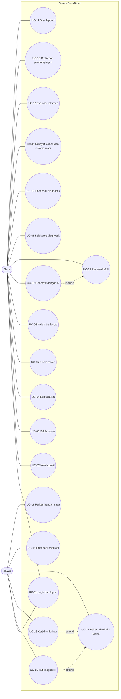

Penjelasan: Guru memiliki 14 use case dan Siswa 6 (termasuk login bersama). UC-07 selalu diikuti UC-08 karena draf AI tidak dapat dipakai sebelum direview. Rekaman suara (UC-17) merupakan ekstensi opsional dari diagnostik dan latihan, yaitu ketika soal bertipe baca lisan. Tidak ada aktor Admin.

## 13.3 Deskripsi Use Case

| ID | Precondition | Main flow | Alternative flow | Exception flow | Postcondition |
|---|---|---|---|---|---|
| UC-01 | Akun aktif | 1. Pengguna isi username dan password. 2. Sistem verifikasi. 3. Sistem terbitkan token dan arahkan sesuai role. 4. Logout menghapus token | Pengguna memilih logout dari menu | Kredensial salah: pesan error. Akun nonaktif: ditolak. Lebih dari 5 percobaan: ditunda satu menit | Sesi aktif atau berakhir |
| UC-02 | Login | 1. Guru membuka profil. 2. Ubah nama, email, atau password. 3. Simpan | Siswa hanya melihat | Validasi gagal: tampil pesan per kolom | Profil diperbarui |
| UC-03 | Login Guru, kelas ada | 1. Guru isi data siswa. 2. Sistem buat akun dan profil. 3. Guru mencatat persetujuan wali. 4. Guru dapat ubah, reset password, atau nonaktifkan | Cari dan filter siswa | Username sudah ada: tolak. Kelas bukan milik Guru: 403 | Data siswa tersimpan |
| UC-04 | Login Guru | 1. Guru isi data kelas. 2. Simpan. 3. Daftar kelas tampil | Pindahkan siswa antar kelas | Hapus kelas berisi siswa: 409 | Data kelas tersimpan |
| UC-05 | Login Guru | 1. Guru isi judul, aspek, tingkat, konten. 2. Simpan. 3. Ubah status aktif atau arsip | Filter daftar materi | Data tidak lengkap: 422 | Materi tersimpan |
| UC-06 | Login Guru | 1. Guru pilih tipe soal. 2. Isi pertanyaan, opsi, kunci atau teks target. 3. Simpan | Filter bank soal | Kunci tidak ada di opsi: 422 | Soal tersimpan |
| UC-07 | Login Guru | 1. Guru isi aspek, tingkat, tema, jumlah. 2. Sistem panggil AI. 3. Draf tampil | Guru mengubah parameter lalu mengulang | API gagal atau timeout: pesan error, buat manual. Batas harian tercapai: 429 | Draf tersimpan berstatus draf |
| UC-08 | Ada draf | 1. Guru baca draf. 2. Setujui, ubah, atau tolak | Setujui sebagian | – | Soal atau materi disetujui atau ditolak |
| UC-09 | Soal disetujui ada | 1. Guru buat tes dan pilih soal. 2. Aktifkan | Edit tes sebelum diaktifkan | Aspek kurang: 422 | Tes aktif untuk kelas |
| UC-10 | Ada hasil | 1. Guru pilih siswa atau kelas. 2. Sistem tampilkan skor tiap aspek dan status | Filter per tes | Hasil menunggu penilaian: tampil penanda | Hasil dilihat |
| UC-11 | Ada hasil latihan | 1. Guru buka riwayat. 2. Pilih ganti rekomendasi. 3. Pilih materi dan isi alasan | Hapus penanda pendampingan | Materi tidak aktif: 422 | Rekomendasi baru aktif |
| UC-12 | Rekaman terkirim | 1. Guru buka antrean. 2. Dengarkan. 3. Lihat analisis AI bila ada. 4. Isi nilai, komentar, saran. 5. Simpan | Revisi evaluasi | Audio sudah terhapus karena retensi: evaluasi baru tidak dapat dibuat, tampil pesan. Analisis AI gagal: Guru menilai manual | Evaluasi tersimpan, penguasaan diperbarui |
| UC-13 | Ada riwayat | 1. Guru pilih siswa atau kelas. 2. Grafik dan daftar pendampingan tampil | Filter aspek dan periode | Data kosong: keadaan kosong | Informasi dilihat |
| UC-14 | Ada data periode | 1. Guru pilih siswa atau kelas dan periode. 2. Sistem buat PDF. 3. Guru unduh atau cetak | – | Data kosong: pesan. Gagal: ulangi | PDF tersedia |
| UC-15 | Tes aktif | 1. Siswa mulai tes. 2. Jawab soal. 3. Rekam untuk soal lisan (UC-17). 4. Selesai. 5. Sistem hitung dan simpan | Lanjutkan tes yang berjalan | Koneksi putus: jawaban tersimpan sampai titik terakhir. Tes sudah dikerjakan: 409 | Hasil tersimpan |
| UC-16 | Ada rekomendasi | 1. Siswa pilih latihan. 2. Jawab. 3. Sistem nilai. 4. Rekomendasi berikutnya tampil | Ulangi latihan | Soal belum tersedia: pesan | Hasil latihan tersimpan |
| UC-17 | Izin mikrofon, persetujuan wali = 1 | 1. Rekam. 2. Putar ulang. 3. Kirim. 4. Sistem simpan | Rekam ulang | Izin ditolak: petunjuk. Format atau ukuran salah: 422. Belum ada persetujuan: pesan minta Guru | Rekaman tersimpan |
| UC-18 | Evaluasi ada | 1. Siswa buka hasil. 2. Baca nilai dan komentar | – | Belum dievaluasi: pesan menunggu | Hasil dilihat |
| UC-19 | Ada riwayat | 1. Siswa buka perkembangan. 2. Grafik tampil | – | Data kosong: keadaan kosong | Grafik dilihat |
# 14. Activity Diagram

Semua diagram memakai `flowchart TD` dengan label dalam tanda kutip agar sintaks valid.

## 14.1 dan 14.2 Login Guru dan Login Siswa

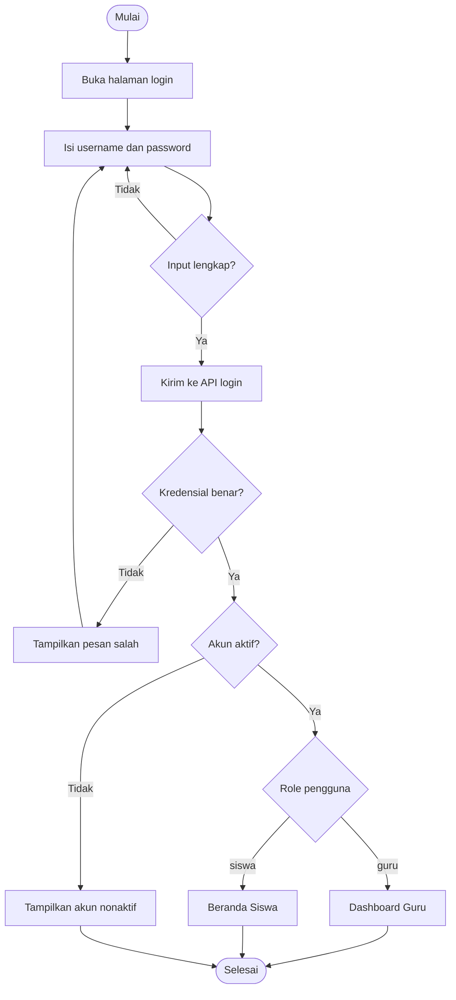

Penjelasan: alur yang sama dipakai kedua role. Pembeda hanya halaman tujuan setelah login berhasil. Percobaan gagal berulang dibatasi 5 per menit.

## 14.3 Pengelolaan Data Siswa

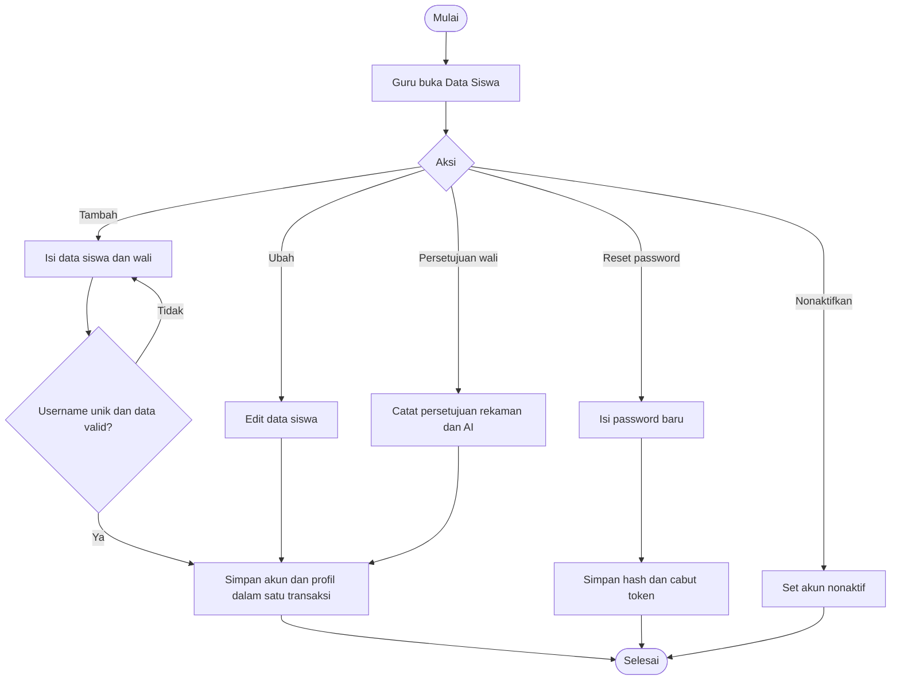

Penjelasan: seluruh perubahan dilakukan Guru. Pembuatan akun dan profil berada dalam satu transaksi agar tidak ada akun tanpa profil.

## 14.4 Pembuatan Materi dengan AI

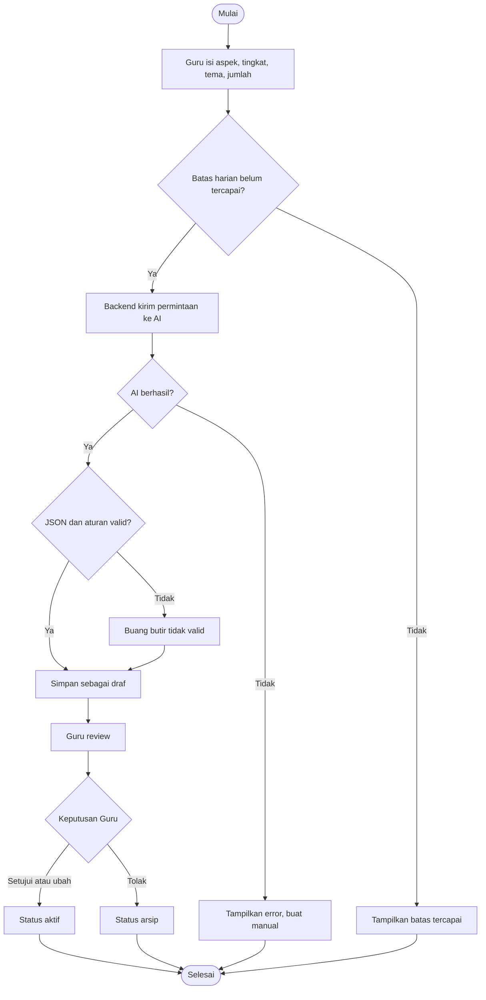

Penjelasan: materi dari AI tidak aktif sebelum Guru menyetujui. Kegagalan AI tidak menghentikan pekerjaan karena Guru dapat membuat materi manual.

## 14.5 Pembuatan Soal Diagnostik

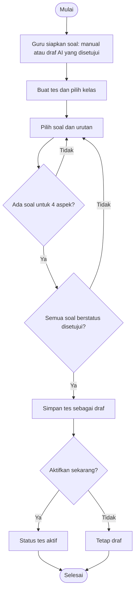

Penjelasan: validasi memastikan tes mencakup empat aspek dan tidak memuat soal yang belum direview.

## 14.6 Pelaksanaan Tes Diagnostik

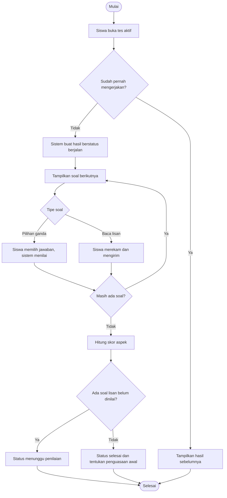

Penjelasan: soal lisan menunda status akhir sampai Guru menilai. Pilihan ganda langsung dinilai.

## 14.7 Penentuan Latihan Adaptif

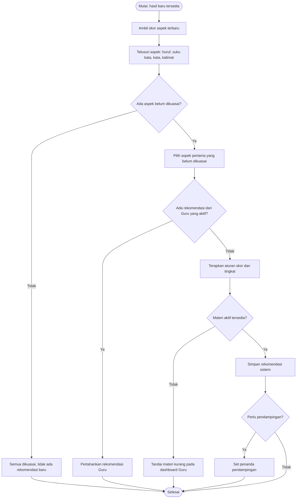

Penjelasan: seluruh keputusan memakai aturan angka pada 11.2. AI tidak terlibat.

## 14.8 Pengerjaan Latihan Siswa

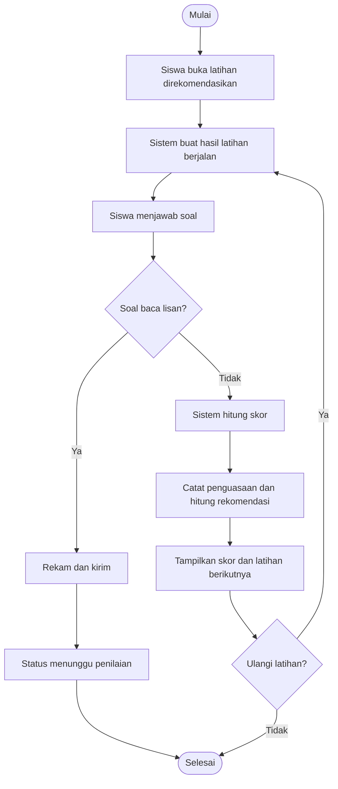

Penjelasan: latihan objektif langsung memicu pembaruan rekomendasi. Latihan lisan menunggu penilaian Guru.

## 14.9 Perekaman Suara Siswa

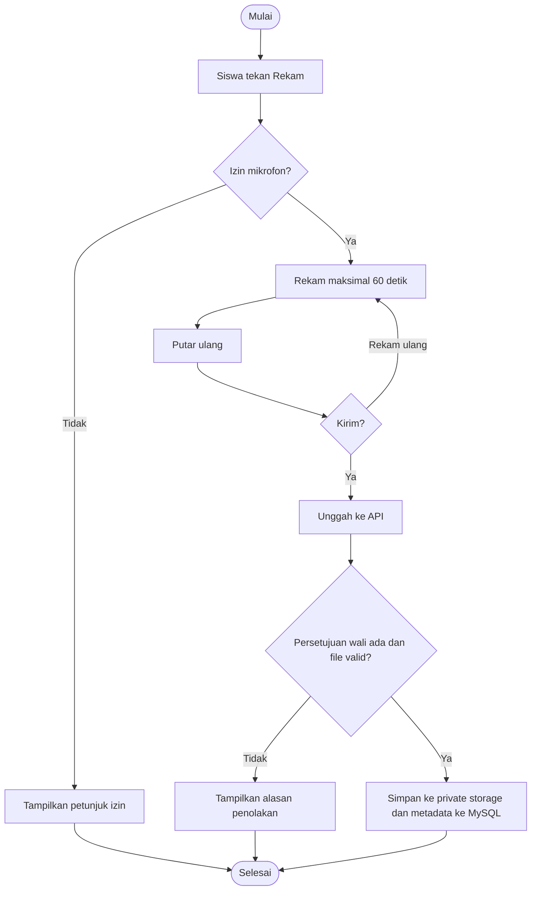

Penjelasan: validasi dilakukan di server, bukan hanya di Flutter.

## 14.10 Analisis Rekaman dengan AI

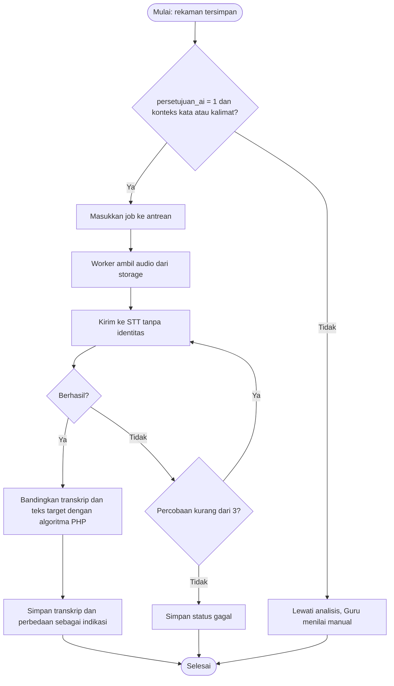

Penjelasan: hasil ditampilkan kepada Guru sebagai pendukung. Kegagalan tidak menghalangi evaluasi.

## 14.11 Evaluasi Rekaman oleh Guru

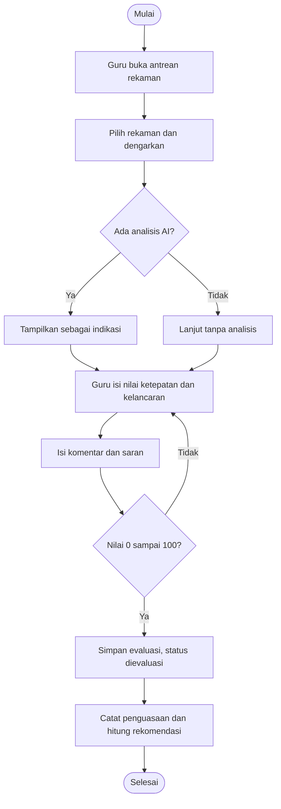

Penjelasan: hanya nilai yang diisi Guru yang disimpan sebagai nilai resmi.

## 14.12 Pembuatan Laporan Perkembangan

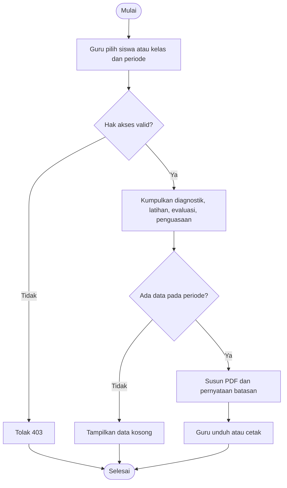

Penjelasan: laporan memuat pernyataan bahwa hasil bukan diagnosis medis atau gangguan belajar (BRL-21).

# 15. Sequence Diagram

Peserta: Flutter (`F`), Laravel API (`L`), MySQL (`D`), Private Storage (`S`), AI API (`A`).

## 15.1 Login Pengguna

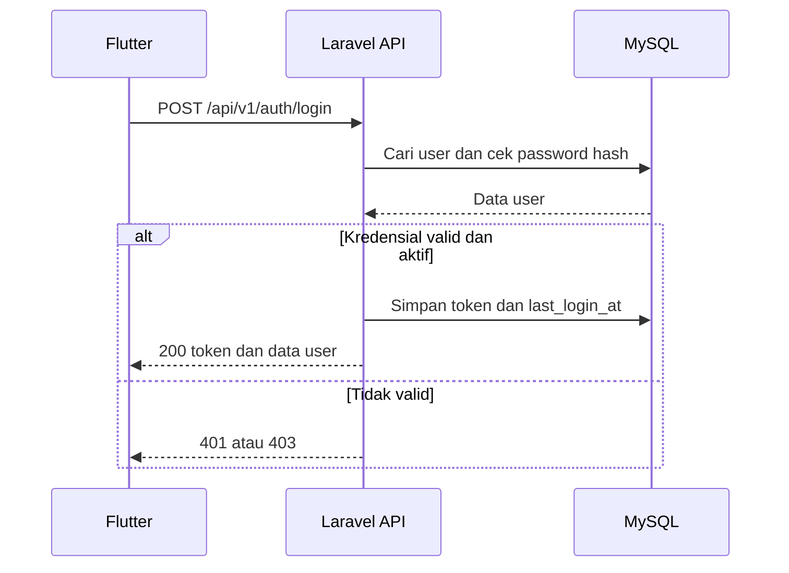

Penjelasan: password dibandingkan dengan hash bcrypt. Token disimpan oleh Sanctum.

## 15.2 Pengambilan Soal Diagnostik

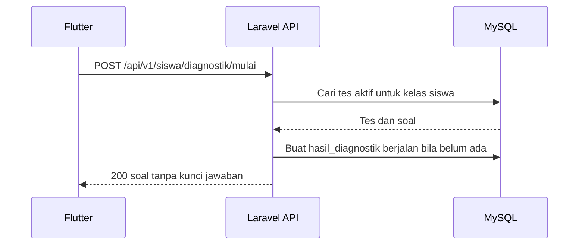

Penjelasan: hasil dibuat lewat POST (bukan GET) agar permintaan baca tidak mengubah data. Kunci jawaban tidak pernah dikirim ke Flutter.

## 15.3 Pengiriman Jawaban Diagnostik

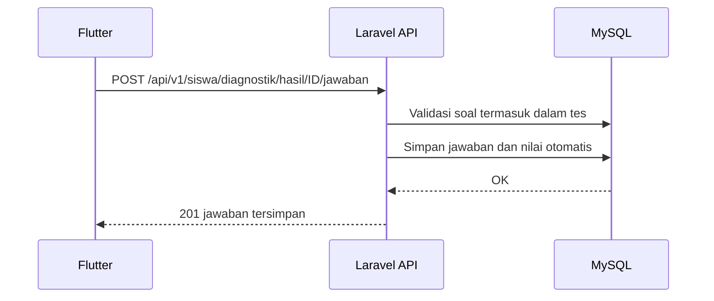

Penjelasan: penilaian pilihan ganda terjadi di server saat jawaban diterima.

## 15.4 Perhitungan Hasil Diagnostik

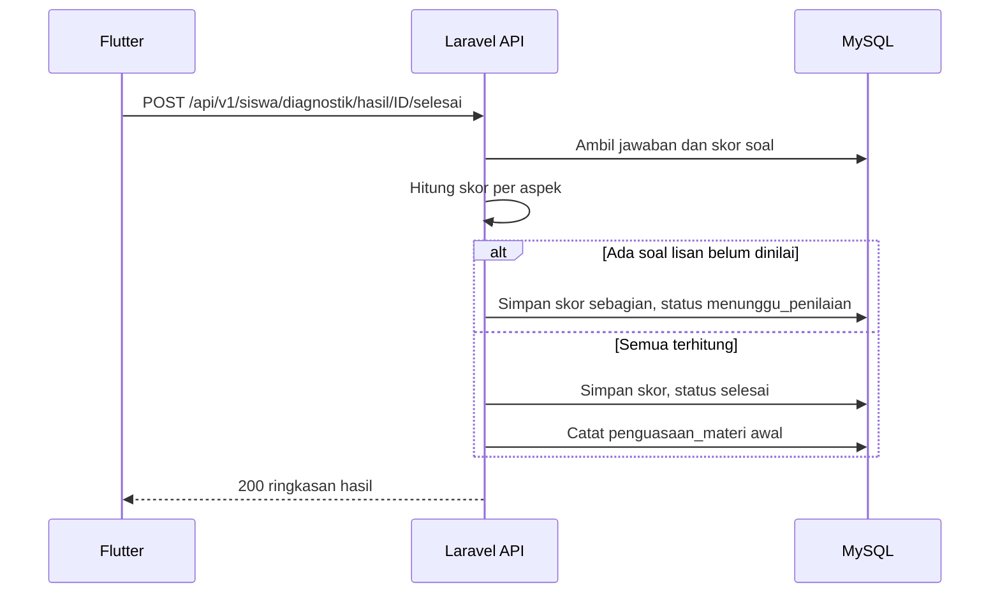

Penjelasan: penguasaan awal hanya dicatat saat hasil selesai penuh.

## 15.5 Penentuan Latihan Adaptif

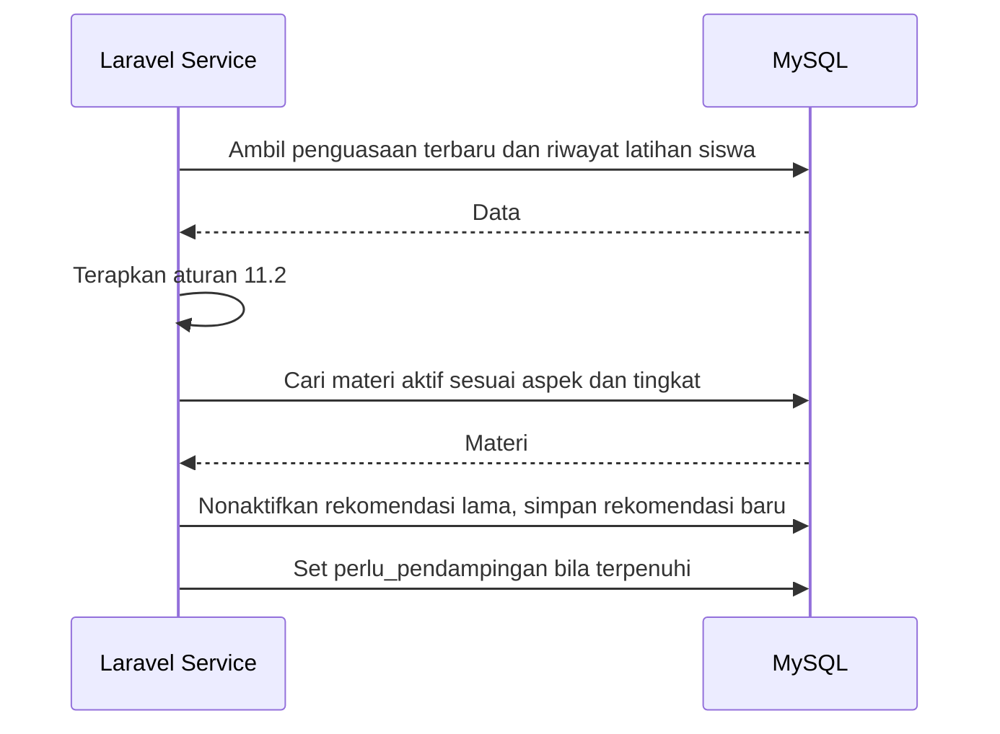

Penjelasan: proses dipicu internal setelah diagnostik selesai, latihan selesai, atau evaluasi disimpan. Tidak ada endpoint publik untuk memicunya selain pembacaan hasil.

## 15.6 Pengiriman Rekaman Audio

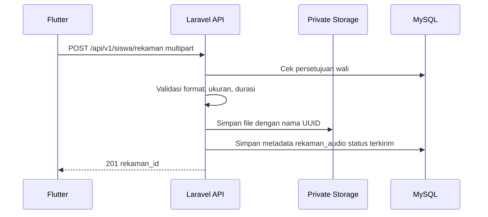

Penjelasan: file tidak disimpan sebagai BLOB. Hanya path dan metadata yang masuk MySQL.

## 15.7 Pemrosesan Rekaman melalui AI

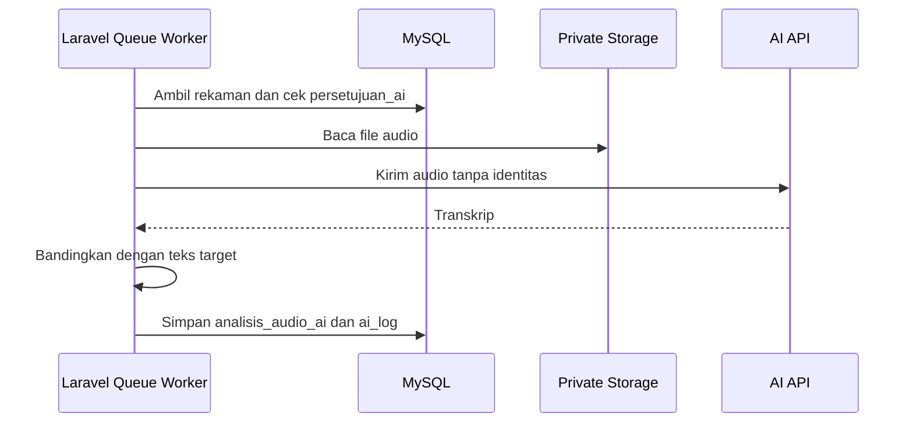

Penjelasan: API key hanya ada di server. Hasil disimpan sebagai analisis pendukung dan tidak mengubah nilai.

## 15.8 Evaluasi Guru

```mermaid
sequenceDiagram
    participant F as Flutter Guru
    participant L as Laravel API
    participant S as Private Storage
    participant D as MySQL
    F->>L: GET /api/v1/guru/rekaman/ID/audio
    L->>D: Cek rekaman milik siswa kelas Guru
    L->>S: Baca file
    L-->>F: Aliran audio
    F->>L: POST /api/v1/guru/rekaman/ID/evaluasi
    L->>D: Simpan evaluasi_audio dan ubah status dievaluasi
    L->>D: Catat penguasaan_materi dan hitung rekomendasi
    L-->>F: 201 evaluasi tersimpan
```

Penjelasan: akses audio hanya lewat endpoint yang memeriksa kepemilikan kelas.

## 15.9 Pengambilan Grafik Perkembangan

```mermaid
sequenceDiagram
    participant F as Flutter
    participant L as Laravel API
    participant D as MySQL
    F->>L: GET /api/v1/siswa/perkembangan
    L->>D: Ambil penguasaan_materi siswa urut waktu
    D-->>L: Baris riwayat
    L-->>F: 200 seri data per aspek
```

Penjelasan: Guru memakai endpoint serupa dengan parameter `siswa_id` dan pengecekan kelas. Grafik digambar di Flutter.

# 16. Rancangan Database

## 16.1 Tabel dan Alasan Penambahan

Sepuluh tabel awal dipertahankan. Tabel berikut ditambahkan karena tanpa tabel itu kebutuhan tidak dapat dipenuhi:

| Tabel tambahan | Alasan |
|---|---|
| `tes_diagnostik` dan `tes_diagnostik_soal` | Tes adalah kumpulan soal untuk kelas. Dibutuhkan agar `hasil_diagnostik` merujuk pada tes tertentu |
| `jawaban_siswa` | Menyimpan jawaban per soal untuk diagnostik dan latihan (detail jawaban per soal) |
| `rekomendasi_latihan` | Menyimpan rekomendasi sistem dan penggantian oleh Guru agar dapat ditelusuri |
| `analisis_audio_ai` | Memisahkan hasil AI dari nilai resmi agar AI tidak bercampur dengan penilaian Guru |
| `ai_log` | Mencatat penggunaan dan biaya AI tanpa menyimpan data siswa |
| `personal_access_tokens` | Tabel standar Laravel Sanctum (dibuat migrasi bawaan, tidak diuraikan) |

Penyesuaian tabel awal: `siswa` memuat kolom wali dan persetujuan. `penguasaan_materi` dibuat tambah-saja agar riwayat dapat ditelusuri.

## 16.2 ERD

```mermaid
erDiagram
    users ||--o| siswa : "memiliki profil"
    users ||--o{ kelas : "mengelola"
    users ||--o{ materi : "membuat"
    users ||--o{ soal : "membuat"
    users ||--o{ tes_diagnostik : "membuat"
    users ||--o{ evaluasi_audio : "menilai"
    users ||--o{ ai_log : "memicu"
    kelas ||--o{ siswa : "berisi"
    kelas ||--o{ tes_diagnostik : "menerima"
    materi ||--o{ soal : "memuat"
    materi ||--o{ hasil_latihan : "dikerjakan"
    materi ||--o{ rekomendasi_latihan : "direkomendasikan"
    tes_diagnostik ||--o{ tes_diagnostik_soal : "memuat"
    soal ||--o{ tes_diagnostik_soal : "dipakai"
    tes_diagnostik ||--o{ hasil_diagnostik : "menghasilkan"
    siswa ||--o{ hasil_diagnostik : "mengerjakan"
    siswa ||--o{ hasil_latihan : "mengerjakan"
    siswa ||--o{ rekaman_audio : "mengirim"
    siswa ||--o{ penguasaan_materi : "memiliki riwayat"
    siswa ||--o{ rekomendasi_latihan : "menerima"
    rekomendasi_latihan ||--o{ hasil_latihan : "mendasari"
    hasil_diagnostik ||--o{ jawaban_siswa : "memuat"
    hasil_latihan ||--o{ jawaban_siswa : "memuat"
    soal ||--o{ jawaban_siswa : "dijawab"
    hasil_diagnostik ||--o{ rekaman_audio : "terkait"
    hasil_latihan ||--o{ rekaman_audio : "terkait"
    soal ||--o{ rekaman_audio : "dibaca"
    rekaman_audio ||--o| evaluasi_audio : "dievaluasi"
    rekaman_audio ||--o{ analisis_audio_ai : "dianalisis"

    users {
        bigint id PK
        varchar nama
        varchar username UK
        varchar email UK
        varchar password
        enum role
        tinyint aktif
    }
    kelas {
        bigint id PK
        bigint guru_id FK
        varchar nama_kelas
        tinyint tingkat
        varchar tahun_ajaran
    }
    siswa {
        bigint id PK
        bigint user_id FK
        bigint kelas_id FK
        varchar nis UK
        varchar nama_wali
        tinyint persetujuan_wali
        tinyint persetujuan_ai
    }
    materi {
        bigint id PK
        bigint guru_id FK
        enum aspek
        tinyint tingkat_kesulitan
        varchar judul
        enum status
    }
    soal {
        bigint id PK
        bigint guru_id FK
        bigint materi_id FK
        enum aspek
        enum tipe
        enum status_review
    }
    tes_diagnostik {
        bigint id PK
        bigint guru_id FK
        bigint kelas_id FK
        varchar judul
        enum status
    }
    tes_diagnostik_soal {
        bigint tes_diagnostik_id PK
        bigint soal_id PK
        smallint urutan
    }
    hasil_diagnostik {
        bigint id PK
        bigint siswa_id FK
        bigint tes_diagnostik_id FK
        decimal skor_huruf
        decimal skor_suku_kata
        decimal skor_kata
        decimal skor_kalimat
        enum status
    }
    hasil_latihan {
        bigint id PK
        bigint siswa_id FK
        bigint materi_id FK
        bigint rekomendasi_id FK
        decimal skor
        tinyint percobaan_ke
        enum status
    }
    jawaban_siswa {
        bigint id PK
        bigint hasil_diagnostik_id FK
        bigint hasil_latihan_id FK
        bigint soal_id FK
        varchar jawaban
        decimal skor_soal
    }
    rekaman_audio {
        bigint id PK
        bigint siswa_id FK
        bigint soal_id FK
        bigint hasil_diagnostik_id FK
        bigint hasil_latihan_id FK
        varchar path_file
        enum status
    }
    evaluasi_audio {
        bigint id PK
        bigint rekaman_id FK
        bigint guru_id FK
        tinyint nilai_ketepatan
        tinyint nilai_kelancaran
    }
    analisis_audio_ai {
        bigint id PK
        bigint rekaman_id FK
        text transkrip
        enum status
    }
    penguasaan_materi {
        bigint id PK
        bigint siswa_id FK
        enum aspek
        decimal skor
        enum status_penguasaan
        tinyint tingkat
    }
    rekomendasi_latihan {
        bigint id PK
        bigint siswa_id FK
        bigint materi_id FK
        enum sumber
        enum status
    }
    ai_log {
        bigint id PK
        bigint guru_id FK
        enum jenis
        varchar model
        enum status
    }
```

## 16.3 Penjelasan Relasi dan Kardinalitas

| Relasi | Kardinalitas | Keterangan |
|---|---|---|
| users – siswa | 1 : 0..1 | Akun siswa memiliki satu profil. Akun Guru tidak punya profil siswa |
| users (guru) – kelas | 1 : N | Guru mengelola banyak kelas |
| kelas – siswa | 1 : N | Satu siswa berada di satu kelas pada satu waktu |
| kelas – tes_diagnostik | 1 : N | Tes dibuat untuk satu kelas |
| tes_diagnostik – soal | N : M | Lewat `tes_diagnostik_soal` |
| siswa – hasil_diagnostik | 1 : N | Satu hasil per siswa per tes (unique) |
| siswa – hasil_latihan | 1 : N | Banyak latihan dan percobaan |
| siswa – rekaman_audio | 1 : N | Banyak rekaman |
| rekaman_audio – evaluasi_audio | 1 : 0..1 | Satu evaluasi per rekaman |
| rekaman_audio – analisis_audio_ai | 1 : N | Analisis dapat diulang bila gagal |
| siswa – penguasaan_materi | 1 : N | Riwayat tambah-saja per aspek |
| hasil_diagnostik atau hasil_latihan – jawaban_siswa | 1 : N | Tepat satu dari dua kolom induk terisi |

Aturan yang ditegakkan di aplikasi karena keterbatasan MySQL: `jawaban_siswa` dan `rekaman_audio` harus memiliki tepat satu dari `hasil_diagnostik_id` atau `hasil_latihan_id`. Aturan ini tidak dibuat sebagai CHECK karena MySQL melarang CHECK pada kolom yang dipakai foreign key dengan aksi referensial (CASCADE atau SET NULL). Validasi dilakukan di FormRequest Laravel dan diuji pada pengujian unit.

## 16.4 Data Dictionary dan SQL CREATE TABLE

Konvensi: mesin InnoDB, `utf8mb4_unicode_ci`, kunci utama `BIGINT UNSIGNED AUTO_INCREMENT`. Kolom `created_at` dan `updated_at` ada pada semua tabel utama.

```sql
CREATE TABLE users (
  id BIGINT UNSIGNED NOT NULL AUTO_INCREMENT,
  nama VARCHAR(100) NOT NULL,
  username VARCHAR(50) NOT NULL,
  email VARCHAR(100) NULL,
  password VARCHAR(255) NOT NULL COMMENT 'hash bcrypt',
  role ENUM('guru','siswa') NOT NULL,
  aktif TINYINT(1) NOT NULL DEFAULT 1,
  last_login_at TIMESTAMP NULL,
  created_at TIMESTAMP NULL,
  updated_at TIMESTAMP NULL,
  PRIMARY KEY (id),
  UNIQUE KEY uq_users_username (username),
  UNIQUE KEY uq_users_email (email),
  KEY idx_users_role (role)
) ENGINE=InnoDB DEFAULT CHARSET=utf8mb4 COLLATE=utf8mb4_unicode_ci;

CREATE TABLE kelas (
  id BIGINT UNSIGNED NOT NULL AUTO_INCREMENT,
  guru_id BIGINT UNSIGNED NOT NULL,
  nama_kelas VARCHAR(30) NOT NULL,
  tingkat TINYINT UNSIGNED NOT NULL,
  tahun_ajaran VARCHAR(9) NOT NULL,
  created_at TIMESTAMP NULL,
  updated_at TIMESTAMP NULL,
  PRIMARY KEY (id),
  UNIQUE KEY uq_kelas (guru_id, nama_kelas, tahun_ajaran),
  CONSTRAINT fk_kelas_guru FOREIGN KEY (guru_id) REFERENCES users(id) ON DELETE RESTRICT,
  CONSTRAINT ck_kelas_tingkat CHECK (tingkat BETWEEN 1 AND 3)
) ENGINE=InnoDB DEFAULT CHARSET=utf8mb4 COLLATE=utf8mb4_unicode_ci;

CREATE TABLE siswa (
  id BIGINT UNSIGNED NOT NULL AUTO_INCREMENT,
  user_id BIGINT UNSIGNED NOT NULL,
  kelas_id BIGINT UNSIGNED NOT NULL,
  nis VARCHAR(20) NULL,
  tanggal_lahir DATE NULL,
  jenis_kelamin ENUM('L','P') NULL,
  nama_wali VARCHAR(100) NOT NULL,
  persetujuan_wali TINYINT(1) NOT NULL DEFAULT 0,
  persetujuan_ai TINYINT(1) NOT NULL DEFAULT 0,
  persetujuan_dicatat_pada DATETIME NULL,
  created_at TIMESTAMP NULL,
  updated_at TIMESTAMP NULL,
  PRIMARY KEY (id),
  UNIQUE KEY uq_siswa_user (user_id),
  UNIQUE KEY uq_siswa_nis (nis),
  KEY idx_siswa_kelas (kelas_id),
  CONSTRAINT fk_siswa_user FOREIGN KEY (user_id) REFERENCES users(id) ON DELETE CASCADE,
  CONSTRAINT fk_siswa_kelas FOREIGN KEY (kelas_id) REFERENCES kelas(id) ON DELETE RESTRICT
) ENGINE=InnoDB DEFAULT CHARSET=utf8mb4 COLLATE=utf8mb4_unicode_ci;

CREATE TABLE materi (
  id BIGINT UNSIGNED NOT NULL AUTO_INCREMENT,
  guru_id BIGINT UNSIGNED NOT NULL,
  aspek ENUM('huruf','suku_kata','kata','kalimat') NOT NULL,
  tingkat_kesulitan TINYINT UNSIGNED NOT NULL,
  judul VARCHAR(150) NOT NULL,
  konten TEXT NOT NULL,
  dibuat_oleh_ai TINYINT(1) NOT NULL DEFAULT 0,
  status ENUM('draft','aktif','arsip') NOT NULL DEFAULT 'draft',
  created_at TIMESTAMP NULL,
  updated_at TIMESTAMP NULL,
  PRIMARY KEY (id),
  KEY idx_materi_pilih (aspek, tingkat_kesulitan, status),
  CONSTRAINT fk_materi_guru FOREIGN KEY (guru_id) REFERENCES users(id) ON DELETE RESTRICT,
  CONSTRAINT ck_materi_tingkat CHECK (tingkat_kesulitan BETWEEN 1 AND 3)
) ENGINE=InnoDB DEFAULT CHARSET=utf8mb4 COLLATE=utf8mb4_unicode_ci;

CREATE TABLE soal (
  id BIGINT UNSIGNED NOT NULL AUTO_INCREMENT,
  guru_id BIGINT UNSIGNED NOT NULL,
  materi_id BIGINT UNSIGNED NULL,
  aspek ENUM('huruf','suku_kata','kata','kalimat') NOT NULL,
  tingkat_kesulitan TINYINT UNSIGNED NOT NULL,
  tipe ENUM('pilihan_ganda','baca_lisan') NOT NULL,
  penggunaan ENUM('diagnostik','latihan','keduanya') NOT NULL DEFAULT 'keduanya',
  pertanyaan TEXT NOT NULL,
  teks_target VARCHAR(255) NULL COMMENT 'wajib untuk baca_lisan',
  opsi_jawaban JSON NULL COMMENT 'wajib untuk pilihan_ganda',
  kunci_jawaban VARCHAR(255) NULL,
  dibuat_oleh_ai TINYINT(1) NOT NULL DEFAULT 0,
  status_review ENUM('draft','disetujui','ditolak') NOT NULL DEFAULT 'draft',
  created_at TIMESTAMP NULL,
  updated_at TIMESTAMP NULL,
  PRIMARY KEY (id),
  KEY idx_soal_pilih (aspek, tingkat_kesulitan, status_review),
  KEY idx_soal_materi (materi_id),
  CONSTRAINT fk_soal_guru FOREIGN KEY (guru_id) REFERENCES users(id) ON DELETE RESTRICT,
  CONSTRAINT fk_soal_materi FOREIGN KEY (materi_id) REFERENCES materi(id) ON DELETE SET NULL
) ENGINE=InnoDB DEFAULT CHARSET=utf8mb4 COLLATE=utf8mb4_unicode_ci;

CREATE TABLE tes_diagnostik (
  id BIGINT UNSIGNED NOT NULL AUTO_INCREMENT,
  guru_id BIGINT UNSIGNED NOT NULL,
  kelas_id BIGINT UNSIGNED NOT NULL,
  judul VARCHAR(150) NOT NULL,
  status ENUM('draft','aktif','selesai') NOT NULL DEFAULT 'draft',
  created_at TIMESTAMP NULL,
  updated_at TIMESTAMP NULL,
  PRIMARY KEY (id),
  KEY idx_tes_kelas_status (kelas_id, status),
  CONSTRAINT fk_tes_guru FOREIGN KEY (guru_id) REFERENCES users(id) ON DELETE RESTRICT,
  CONSTRAINT fk_tes_kelas FOREIGN KEY (kelas_id) REFERENCES kelas(id) ON DELETE RESTRICT
) ENGINE=InnoDB DEFAULT CHARSET=utf8mb4 COLLATE=utf8mb4_unicode_ci;

CREATE TABLE tes_diagnostik_soal (
  tes_diagnostik_id BIGINT UNSIGNED NOT NULL,
  soal_id BIGINT UNSIGNED NOT NULL,
  urutan SMALLINT UNSIGNED NOT NULL,
  PRIMARY KEY (tes_diagnostik_id, soal_id),
  KEY idx_tds_soal (soal_id),
  CONSTRAINT fk_tds_tes FOREIGN KEY (tes_diagnostik_id) REFERENCES tes_diagnostik(id) ON DELETE CASCADE,
  CONSTRAINT fk_tds_soal FOREIGN KEY (soal_id) REFERENCES soal(id) ON DELETE RESTRICT
) ENGINE=InnoDB DEFAULT CHARSET=utf8mb4 COLLATE=utf8mb4_unicode_ci;

CREATE TABLE hasil_diagnostik (
  id BIGINT UNSIGNED NOT NULL AUTO_INCREMENT,
  siswa_id BIGINT UNSIGNED NOT NULL,
  tes_diagnostik_id BIGINT UNSIGNED NOT NULL,
  skor_huruf DECIMAL(5,2) NULL,
  skor_suku_kata DECIMAL(5,2) NULL,
  skor_kata DECIMAL(5,2) NULL,
  skor_kalimat DECIMAL(5,2) NULL,
  status ENUM('berjalan','menunggu_penilaian','selesai') NOT NULL DEFAULT 'berjalan',
  mulai_pada DATETIME NOT NULL,
  selesai_pada DATETIME NULL,
  created_at TIMESTAMP NULL,
  updated_at TIMESTAMP NULL,
  PRIMARY KEY (id),
  UNIQUE KEY uq_hasil_diag (siswa_id, tes_diagnostik_id),
  KEY idx_hd_tes (tes_diagnostik_id),
  CONSTRAINT fk_hd_siswa FOREIGN KEY (siswa_id) REFERENCES siswa(id) ON DELETE RESTRICT,
  CONSTRAINT fk_hd_tes FOREIGN KEY (tes_diagnostik_id) REFERENCES tes_diagnostik(id) ON DELETE RESTRICT
) ENGINE=InnoDB DEFAULT CHARSET=utf8mb4 COLLATE=utf8mb4_unicode_ci;

CREATE TABLE rekomendasi_latihan (
  id BIGINT UNSIGNED NOT NULL AUTO_INCREMENT,
  siswa_id BIGINT UNSIGNED NOT NULL,
  materi_id BIGINT UNSIGNED NOT NULL,
  aspek ENUM('huruf','suku_kata','kata','kalimat') NOT NULL,
  alasan VARCHAR(255) NOT NULL,
  sumber ENUM('sistem','guru') NOT NULL DEFAULT 'sistem',
  status ENUM('aktif','selesai','dibatalkan') NOT NULL DEFAULT 'aktif',
  dibuat_oleh BIGINT UNSIGNED NULL,
  created_at TIMESTAMP NULL,
  updated_at TIMESTAMP NULL,
  PRIMARY KEY (id),
  KEY idx_rek_siswa_status (siswa_id, status),
  CONSTRAINT fk_rek_siswa FOREIGN KEY (siswa_id) REFERENCES siswa(id) ON DELETE RESTRICT,
  CONSTRAINT fk_rek_materi FOREIGN KEY (materi_id) REFERENCES materi(id) ON DELETE RESTRICT,
  CONSTRAINT fk_rek_guru FOREIGN KEY (dibuat_oleh) REFERENCES users(id) ON DELETE SET NULL
) ENGINE=InnoDB DEFAULT CHARSET=utf8mb4 COLLATE=utf8mb4_unicode_ci;

CREATE TABLE hasil_latihan (
  id BIGINT UNSIGNED NOT NULL AUTO_INCREMENT,
  siswa_id BIGINT UNSIGNED NOT NULL,
  materi_id BIGINT UNSIGNED NOT NULL,
  rekomendasi_id BIGINT UNSIGNED NULL,
  skor DECIMAL(5,2) NULL,
  jumlah_benar SMALLINT UNSIGNED NULL,
  jumlah_soal SMALLINT UNSIGNED NULL,
  percobaan_ke TINYINT UNSIGNED NOT NULL DEFAULT 1,
  status ENUM('berjalan','menunggu_penilaian','selesai') NOT NULL DEFAULT 'berjalan',
  mulai_pada DATETIME NOT NULL,
  selesai_pada DATETIME NULL,
  created_at TIMESTAMP NULL,
  updated_at TIMESTAMP NULL,
  PRIMARY KEY (id),
  KEY idx_hl_siswa_waktu (siswa_id, mulai_pada),
  KEY idx_hl_materi (materi_id),
  CONSTRAINT fk_hl_siswa FOREIGN KEY (siswa_id) REFERENCES siswa(id) ON DELETE RESTRICT,
  CONSTRAINT fk_hl_materi FOREIGN KEY (materi_id) REFERENCES materi(id) ON DELETE RESTRICT,
  CONSTRAINT fk_hl_rek FOREIGN KEY (rekomendasi_id) REFERENCES rekomendasi_latihan(id) ON DELETE SET NULL
) ENGINE=InnoDB DEFAULT CHARSET=utf8mb4 COLLATE=utf8mb4_unicode_ci;

CREATE TABLE jawaban_siswa (
  id BIGINT UNSIGNED NOT NULL AUTO_INCREMENT,
  hasil_diagnostik_id BIGINT UNSIGNED NULL,
  hasil_latihan_id BIGINT UNSIGNED NULL,
  soal_id BIGINT UNSIGNED NOT NULL,
  jawaban VARCHAR(255) NULL,
  benar TINYINT(1) NULL,
  skor_soal DECIMAL(5,2) NULL COMMENT '0-100, soal lisan diisi setelah evaluasi Guru',
  created_at TIMESTAMP NULL,
  updated_at TIMESTAMP NULL,
  PRIMARY KEY (id),
  UNIQUE KEY uq_js_diag (hasil_diagnostik_id, soal_id),
  UNIQUE KEY uq_js_latihan (hasil_latihan_id, soal_id),
  KEY idx_js_soal (soal_id),
  CONSTRAINT fk_js_hd FOREIGN KEY (hasil_diagnostik_id) REFERENCES hasil_diagnostik(id) ON DELETE CASCADE,
  CONSTRAINT fk_js_hl FOREIGN KEY (hasil_latihan_id) REFERENCES hasil_latihan(id) ON DELETE CASCADE,
  CONSTRAINT fk_js_soal FOREIGN KEY (soal_id) REFERENCES soal(id) ON DELETE RESTRICT
) ENGINE=InnoDB DEFAULT CHARSET=utf8mb4 COLLATE=utf8mb4_unicode_ci;

CREATE TABLE rekaman_audio (
  id BIGINT UNSIGNED NOT NULL AUTO_INCREMENT,
  siswa_id BIGINT UNSIGNED NOT NULL,
  soal_id BIGINT UNSIGNED NOT NULL,
  hasil_diagnostik_id BIGINT UNSIGNED NULL,
  hasil_latihan_id BIGINT UNSIGNED NULL,
  path_file VARCHAR(255) NULL COMMENT 'NULL setelah file dihapus (retensi)',
  mime_type VARCHAR(50) NOT NULL,
  ukuran_byte INT UNSIGNED NOT NULL,
  durasi_detik SMALLINT UNSIGNED NOT NULL,
  status ENUM('terkirim','dievaluasi') NOT NULL DEFAULT 'terkirim',
  dikirim_pada DATETIME NOT NULL,
  hapus_setelah DATE NULL,
  file_dihapus_pada DATETIME NULL,
  created_at TIMESTAMP NULL,
  updated_at TIMESTAMP NULL,
  PRIMARY KEY (id),
  KEY idx_ra_siswa (siswa_id),
  KEY idx_ra_status (status, dikirim_pada),
  KEY idx_ra_hapus (hapus_setelah),
  CONSTRAINT fk_ra_siswa FOREIGN KEY (siswa_id) REFERENCES siswa(id) ON DELETE RESTRICT,
  CONSTRAINT fk_ra_soal FOREIGN KEY (soal_id) REFERENCES soal(id) ON DELETE RESTRICT,
  CONSTRAINT fk_ra_hd FOREIGN KEY (hasil_diagnostik_id) REFERENCES hasil_diagnostik(id) ON DELETE SET NULL,
  CONSTRAINT fk_ra_hl FOREIGN KEY (hasil_latihan_id) REFERENCES hasil_latihan(id) ON DELETE SET NULL
) ENGINE=InnoDB DEFAULT CHARSET=utf8mb4 COLLATE=utf8mb4_unicode_ci;

CREATE TABLE evaluasi_audio (
  id BIGINT UNSIGNED NOT NULL AUTO_INCREMENT,
  rekaman_id BIGINT UNSIGNED NOT NULL,
  guru_id BIGINT UNSIGNED NOT NULL,
  nilai_ketepatan TINYINT UNSIGNED NOT NULL,
  nilai_kelancaran TINYINT UNSIGNED NOT NULL,
  komentar TEXT NULL,
  saran TEXT NULL,
  created_at TIMESTAMP NULL,
  updated_at TIMESTAMP NULL,
  PRIMARY KEY (id),
  UNIQUE KEY uq_eval_rekaman (rekaman_id),
  KEY idx_eval_guru (guru_id),
  CONSTRAINT fk_eval_rekaman FOREIGN KEY (rekaman_id) REFERENCES rekaman_audio(id) ON DELETE RESTRICT,
  CONSTRAINT fk_eval_guru FOREIGN KEY (guru_id) REFERENCES users(id) ON DELETE RESTRICT,
  CONSTRAINT ck_eval_ketepatan CHECK (nilai_ketepatan BETWEEN 0 AND 100),
  CONSTRAINT ck_eval_kelancaran CHECK (nilai_kelancaran BETWEEN 0 AND 100)
) ENGINE=InnoDB DEFAULT CHARSET=utf8mb4 COLLATE=utf8mb4_unicode_ci;

CREATE TABLE analisis_audio_ai (
  id BIGINT UNSIGNED NOT NULL AUTO_INCREMENT,
  rekaman_id BIGINT UNSIGNED NOT NULL,
  transkrip TEXT NULL,
  kata_terlewat JSON NULL,
  kata_berbeda JSON NULL,
  kata_berulang JSON NULL,
  skor_kemiripan DECIMAL(5,2) NULL COMMENT 'indikatif, bukan nilai resmi',
  model VARCHAR(60) NULL,
  status ENUM('berhasil','gagal') NOT NULL,
  pesan_error VARCHAR(255) NULL,
  created_at TIMESTAMP NULL,
  updated_at TIMESTAMP NULL,
  PRIMARY KEY (id),
  KEY idx_aai_rekaman (rekaman_id),
  CONSTRAINT fk_aai_rekaman FOREIGN KEY (rekaman_id) REFERENCES rekaman_audio(id) ON DELETE CASCADE
) ENGINE=InnoDB DEFAULT CHARSET=utf8mb4 COLLATE=utf8mb4_unicode_ci;

CREATE TABLE penguasaan_materi (
  id BIGINT UNSIGNED NOT NULL AUTO_INCREMENT,
  siswa_id BIGINT UNSIGNED NOT NULL,
  aspek ENUM('huruf','suku_kata','kata','kalimat') NOT NULL,
  skor DECIMAL(5,2) NOT NULL,
  tingkat TINYINT UNSIGNED NOT NULL DEFAULT 1,
  status_penguasaan ENUM('belum_dikuasai','sedang_berlatih','dikuasai') NOT NULL,
  perlu_pendampingan TINYINT(1) NOT NULL DEFAULT 0,
  sumber ENUM('diagnostik','latihan','evaluasi_guru') NOT NULL,
  sumber_id BIGINT UNSIGNED NOT NULL COMMENT 'id hasil_diagnostik, hasil_latihan, atau evaluasi_audio menurut kolom sumber (tanpa FK)',
  dicatat_pada DATETIME NOT NULL,
  created_at TIMESTAMP NULL,
  updated_at TIMESTAMP NULL,
  PRIMARY KEY (id),
  KEY idx_pm_riwayat (siswa_id, aspek, dicatat_pada),
  CONSTRAINT fk_pm_siswa FOREIGN KEY (siswa_id) REFERENCES siswa(id) ON DELETE RESTRICT
) ENGINE=InnoDB DEFAULT CHARSET=utf8mb4 COLLATE=utf8mb4_unicode_ci;

CREATE TABLE ai_log (
  id BIGINT UNSIGNED NOT NULL AUTO_INCREMENT,
  guru_id BIGINT UNSIGNED NULL,
  jenis ENUM('materi','soal','analisis_audio','narasi_saran') NOT NULL,
  model VARCHAR(60) NULL,
  token_masukan INT UNSIGNED NULL,
  token_keluaran INT UNSIGNED NULL,
  durasi_audio_detik SMALLINT UNSIGNED NULL,
  status ENUM('berhasil','gagal') NOT NULL,
  durasi_ms INT UNSIGNED NULL,
  created_at TIMESTAMP NULL,
  updated_at TIMESTAMP NULL,
  PRIMARY KEY (id),
  KEY idx_ailog_guru_tanggal (guru_id, created_at),
  CONSTRAINT fk_ailog_guru FOREIGN KEY (guru_id) REFERENCES users(id) ON DELETE SET NULL
) ENGINE=InnoDB DEFAULT CHARSET=utf8mb4 COLLATE=utf8mb4_unicode_ci;
```

Penjelasan keputusan desain:
- Tidak ada BLOB. File audio berada di storage privat dan `path_file` menjadi NULL setelah dihapus saat retensi, sehingga nilai evaluasi tetap tersimpan.
- `penguasaan_materi` tambah-saja: status terbaru per aspek adalah baris dengan `dicatat_pada` terbaru. Grafik memakai seluruh baris.
- Semua FK memakai `ON DELETE RESTRICT` untuk data penilaian agar riwayat tidak hilang tak sengaja. `CASCADE` hanya pada data turunan yang tidak berarti tanpa induknya.
- Untuk kolom nilai ketepatan dan kelancaran, CHECK aman karena kolom tersebut bukan bagian dari FK.
- Dengan `soal` pada tes diagnostik bertipe `baca_lisan`, `rekaman_audio.soal_id` menghubungkan rekaman ke soal. Skor soal lisan diperbarui pada `jawaban_siswa.skor_soal` setelah evaluasi.

## 16.5 Data Dummy

```sql
INSERT INTO users (id, nama, username, email, password, role, aktif) VALUES
 (1, 'Bu Rina Marlina', 'rina.guru', 'rina@example.sch.id', '$2y$12$CONTOHHASHBCRYPT_GURU', 'guru', 1),
 (2, 'Andi Pratama', 'andi.1a', NULL, '$2y$12$CONTOHHASHBCRYPT_ANDI', 'siswa', 1),
 (3, 'Siti Aisyah', 'siti.1a', NULL, '$2y$12$CONTOHHASHBCRYPT_SITI', 'siswa', 1);

INSERT INTO kelas (id, guru_id, nama_kelas, tingkat, tahun_ajaran) VALUES (1, 1, '1A', 1, '2026/2027');

INSERT INTO siswa (id, user_id, kelas_id, nis, nama_wali, persetujuan_wali, persetujuan_ai, persetujuan_dicatat_pada) VALUES
 (1, 2, 1, '2601001', 'Bapak Pratama', 1, 1, '2026-11-02 08:00:00'),
 (2, 3, 1, '2601002', 'Ibu Aminah', 1, 0, '2026-11-02 08:05:00');

INSERT INTO materi (id, guru_id, aspek, tingkat_kesulitan, judul, konten, status) VALUES
 (1, 1, 'suku_kata', 1, 'Suku kata ba bi bu be bo', 'ba bi bu be bo', 'aktif'),
 (2, 1, 'suku_kata', 1, 'Suku kata ka ki ku ke ko', 'ka ki ku ke ko', 'aktif');

INSERT INTO soal (id, guru_id, materi_id, aspek, tingkat_kesulitan, tipe, penggunaan, pertanyaan, teks_target, opsi_jawaban, kunci_jawaban, status_review) VALUES
 (1, 1, NULL, 'huruf', 1, 'pilihan_ganda', 'diagnostik', 'Pilih huruf yang kamu dengar: "b"', NULL, '["b","d","p"]', 'b', 'disetujui'),
 (2, 1, 1, 'suku_kata', 1, 'pilihan_ganda', 'keduanya', 'Pilih suku kata: "bu"', NULL, '["ba","bu","bi"]', 'bu', 'disetujui'),
 (3, 1, NULL, 'kata', 1, 'baca_lisan', 'diagnostik', 'Bacalah kata ini', 'bola', NULL, NULL, 'disetujui'),
 (4, 1, NULL, 'kalimat', 1, 'baca_lisan', 'diagnostik', 'Bacalah kalimat ini', 'Ibu membeli bola', NULL, NULL, 'disetujui');

INSERT INTO tes_diagnostik (id, guru_id, kelas_id, judul, status) VALUES (1, 1, 1, 'Diagnostik Awal Kelas 1A', 'aktif');
INSERT INTO tes_diagnostik_soal (tes_diagnostik_id, soal_id, urutan) VALUES (1,1,1),(1,2,2),(1,3,3),(1,4,4);

INSERT INTO hasil_diagnostik (id, siswa_id, tes_diagnostik_id, skor_huruf, skor_suku_kata, skor_kata, skor_kalimat, status, mulai_pada, selesai_pada) VALUES
 (1, 1, 1, 100.00, 0.00, 70.00, 60.00, 'selesai', '2026-11-05 09:00:00', '2026-11-05 09:12:00');

INSERT INTO jawaban_siswa (hasil_diagnostik_id, hasil_latihan_id, soal_id, jawaban, benar, skor_soal) VALUES
 (1, NULL, 1, 'b', 1, 100.00),
 (1, NULL, 2, 'ba', 0, 0.00),
 (1, NULL, 3, NULL, NULL, 70.00),
 (1, NULL, 4, NULL, NULL, 60.00);

INSERT INTO rekomendasi_latihan (id, siswa_id, materi_id, aspek, alasan, sumber, status) VALUES
 (1, 1, 1, 'suku_kata', 'Suku kata 0, aspek pertama yang belum dikuasai', 'sistem', 'aktif');

INSERT INTO hasil_latihan (id, siswa_id, materi_id, rekomendasi_id, skor, jumlah_benar, jumlah_soal, percobaan_ke, status, mulai_pada, selesai_pada) VALUES
 (1, 1, 1, 1, 60.00, 3, 5, 1, 'selesai', '2026-11-06 09:00:00', '2026-11-06 09:08:00');

INSERT INTO rekaman_audio (id, siswa_id, soal_id, hasil_diagnostik_id, path_file, mime_type, ukuran_byte, durasi_detik, status, dikirim_pada, hapus_setelah) VALUES
 (1, 1, 3, 1, 'rekaman/2026/11/9f2c1e7a-3b4d-4c5e-8a1f-0b2d3c4e5f60.m4a', 'audio/mp4', 182340, 6, 'dievaluasi', '2026-11-05 09:08:00', '2027-02-03'),
 (2, 1, 4, 1, 'rekaman/2026/11/1a7b5c3d-9e2f-4a6b-b8c1-2d3e4f5a6b70.m4a', 'audio/mp4', 305120, 9, 'dievaluasi', '2026-11-05 09:10:00', '2027-02-03');

INSERT INTO evaluasi_audio (rekaman_id, guru_id, nilai_ketepatan, nilai_kelancaran, komentar, saran) VALUES
 (1, 1, 75, 65, 'Sudah benar, masih terbata pada suku kata kedua.', 'Latih bo-la secara perlahan.'),
 (2, 1, 60, 60, 'Kalimat terbaca, beberapa kata terlewat.', 'Baca kalimat pendek dengan jari menunjuk kata.');

INSERT INTO analisis_audio_ai (rekaman_id, transkrip, kata_terlewat, kata_berbeda, kata_berulang, skor_kemiripan, model, status) VALUES
 (1, 'bo bola', '[]', '[]', '["bo"]', 90.00, 'contoh-model-stt', 'berhasil');

INSERT INTO penguasaan_materi (siswa_id, aspek, skor, tingkat, status_penguasaan, perlu_pendampingan, sumber, sumber_id, dicatat_pada) VALUES
 (1, 'huruf', 100.00, 3, 'dikuasai', 0, 'diagnostik', 1, '2026-11-05 09:12:00'),
 (1, 'suku_kata', 0.00, 1, 'belum_dikuasai', 0, 'diagnostik', 1, '2026-11-05 09:12:00'),
 (1, 'kata', 70.00, 2, 'sedang_berlatih', 0, 'diagnostik', 1, '2026-11-05 09:12:00'),
 (1, 'kalimat', 60.00, 2, 'sedang_berlatih', 0, 'diagnostik', 1, '2026-11-05 09:12:00'),
 (1, 'suku_kata', 60.00, 1, 'sedang_berlatih', 0, 'latihan', 1, '2026-11-06 09:08:00');

INSERT INTO ai_log (guru_id, jenis, model, token_masukan, token_keluaran, status, durasi_ms) VALUES
 (1, 'soal', 'contoh-model-llm', 420, 650, 'berhasil', 3100),
 (NULL, 'analisis_audio', 'contoh-model-stt', NULL, NULL, 'berhasil', 2200);
```

Catatan data dummy: nilai `password` adalah placeholder, bukan hash asli. Nama model adalah contoh. Skor soal baca lisan pada `jawaban_siswa` terisi setelah Guru mengevaluasi: soal kata = (75 + 65) / 2 = 70 dan soal kalimat = (60 + 60) / 2 = 60.
# 17. Rancangan API

## 17.1 Konvensi Umum

- Basis URL: `/api/v1`. Format JSON (UTF-8). Kecuali login, semua endpoint memakai header `Authorization: Bearer <token>`.
- Middleware: `auth:sanctum` untuk semua endpoint terlindungi. `role:guru` untuk awalan `/guru/*`. `role:siswa` untuk awalan `/siswa/*`. `throttle:60,1` untuk API dan `throttle:5,1` untuk login. Policy Laravel memeriksa kepemilikan data (kelas milik Guru, `siswa_id` milik Siswa yang login).
- Seluruh `{id}` pada URL diverifikasi terhadap pemilik. Data milik pihak lain dijawab 404 (bukan 403) agar keberadaan data tidak bocor.
- **Tidak ada endpoint yang menerima, mengembalikan, atau meneruskan API key AI.** Semua pemanggilan AI dilakukan server.
- Format sukses: `{"success": true, "message": "...", "data": {...}}`. Format gagal: `{"success": false, "message": "...", "errors": {"kolom": ["pesan"]}}`.

| Kode | Arti |
|---|---|
| 200 | Berhasil |
| 201 | Data dibuat |
| 202 | Diterima, diproses di antrean |
| 401 | Belum login atau token tidak valid |
| 403 | Role atau kondisi tidak diizinkan (misalnya belum ada persetujuan wali) |
| 404 | Data tidak ada atau bukan milik pengguna |
| 409 | Konflik status (tes sudah dikerjakan, kelas berisi siswa) |
| 422 | Validasi gagal |
| 429 | Terlalu banyak permintaan atau batas harian AI tercapai |
| 503 | Layanan AI tidak tersedia |

## 17.2 Authentication

| Method | URL | Aktor | Tujuan | Request dan validasi | Response |
|---|---|---|---|---|---|
| POST | /auth/login | Publik | Login | `username` wajib, `password` wajib min 8, `device_name` wajib | 200 token. 401, 403, 422, 429 |
| POST | /auth/logout | Guru, Siswa | Hapus token aktif | – | 200 |
| GET | /auth/me | Guru, Siswa | Profil login | – | 200 data user (+ profil siswa) |
| PUT | /auth/password | Guru | Ganti password | `password_lama`, `password_baru` min 8 dan beda | 200. 422 |

Contoh request login:
```json
{"username": "andi.1a", "password": "rahasia123", "device_name": "tablet-kelas-1a"}
```
Contoh response:
```json
{
  "success": true,
  "message": "Login berhasil",
  "data": {
    "token": "1|a8f3...contoh",
    "user": {"id": 2, "nama": "Andi Pratama", "role": "siswa"}
  }
}
```

## 17.3 Guru (dashboard, profil, siswa)

| Method | URL | Aktor | Tujuan | Request dan validasi | Response |
|---|---|---|---|---|---|
| GET | /guru/dashboard | Guru | Ringkasan dashboard | – | 200 |
| PUT | /guru/profil | Guru | Ubah profil | `nama`, `email` unik | 200. 422 |
| GET | /guru/siswa | Guru | Daftar siswa | `kelas_id`, `q`, `page` | 200 terpaginasi |
| POST | /guru/siswa | Guru | Tambah siswa | `nama`, `username` unik, `password` min 8, `kelas_id` milik Guru, `nama_wali` | 201. 422 |
| GET | /guru/siswa/{id} | Guru | Detail siswa | – | 200. 404 |
| PUT | /guru/siswa/{id} | Guru | Ubah siswa | seperti tambah (tanpa password) | 200. 422 |
| PATCH | /guru/siswa/{id}/status | Guru | Aktifkan atau nonaktifkan | `aktif` boolean | 200 |
| POST | /guru/siswa/{id}/reset-password | Guru | Reset password | `password_baru` min 8 | 200 |
| PUT | /guru/siswa/{id}/persetujuan | Guru | Catat persetujuan wali | `persetujuan_wali`, `persetujuan_ai` boolean | 200 |

Contoh request tambah siswa:
```json
{
  "nama": "Andi Pratama",
  "username": "andi.1a",
  "password": "rahasia123",
  "kelas_id": 1,
  "nis": "2601001",
  "nama_wali": "Bapak Pratama"
}
```
Contoh response:
```json
{
  "success": true,
  "message": "Siswa berhasil dibuat",
  "data": {"siswa_id": 1, "user_id": 2, "nama": "Andi Pratama", "kelas": "1A", "persetujuan_wali": false, "persetujuan_ai": false}
}
```

## 17.4 Siswa (beranda, profil)

| Method | URL | Aktor | Tujuan | Request | Response |
|---|---|---|---|---|---|
| GET | /siswa/beranda | Siswa | Beranda: rekomendasi aktif, aktivitas, evaluasi terbaru | – | 200 |
| GET | /siswa/profil | Siswa | Profil sendiri | – | 200 (nama, kelas) |

## 17.5 Kelas

| Method | URL | Aktor | Tujuan | Request dan validasi | Response |
|---|---|---|---|---|---|
| GET | /guru/kelas | Guru | Daftar kelas | – | 200 |
| POST | /guru/kelas | Guru | Tambah kelas | `nama_kelas`, `tingkat` 1–3, `tahun_ajaran` format `YYYY/YYYY` | 201. 422 |
| PUT | /guru/kelas/{id} | Guru | Ubah kelas | seperti tambah | 200 |
| DELETE | /guru/kelas/{id} | Guru | Hapus kelas kosong | – | 200. 409 |
| PATCH | /guru/siswa/{id}/kelas | Guru | Pindah kelas siswa | `kelas_id` milik Guru | 200 |

## 17.6 Materi

| Method | URL | Aktor | Tujuan | Request dan validasi | Response |
|---|---|---|---|---|---|
| GET | /guru/materi | Guru | Daftar materi | `aspek`, `tingkat`, `status`, `page` | 200 |
| POST | /guru/materi | Guru | Tambah materi | `judul`, `aspek`, `tingkat_kesulitan` 1–3, `konten` | 201. 422 |
| GET | /guru/materi/{id} | Guru | Detail | – | 200 |
| PUT | /guru/materi/{id} | Guru | Ubah | seperti tambah | 200 |
| PATCH | /guru/materi/{id}/status | Guru | Setujui, aktifkan, arsipkan | `status` dalam `aktif`, `arsip` | 200 |

## 17.7 Soal

| Method | URL | Aktor | Tujuan | Request dan validasi | Response |
|---|---|---|---|---|---|
| GET | /guru/soal | Guru | Daftar soal | `aspek`, `tingkat`, `tipe`, `status_review` | 200 |
| POST | /guru/soal | Guru | Tambah soal | `aspek`, `tingkat_kesulitan`, `tipe`, `penggunaan`, `pertanyaan`. Pilihan ganda: `opsi_jawaban` min 2 dan `kunci_jawaban` ada di opsi. Baca lisan: `teks_target` | 201. 422 |
| PUT | /guru/soal/{id} | Guru | Ubah soal | seperti tambah | 200 |
| DELETE | /guru/soal/{id} | Guru | Hapus soal yang belum dipakai | – | 200. 409 jika sudah dipakai tes atau jawaban |
| PATCH | /guru/soal/{id}/review | Guru | Setujui atau tolak draf | `status_review` dalam `disetujui`, `ditolak` | 200 |

## 17.8 Diagnostik

| Method | URL | Aktor | Tujuan | Request dan validasi | Response |
|---|---|---|---|---|---|
| GET | /guru/diagnostik | Guru | Daftar tes | `kelas_id`, `status` | 200 |
| POST | /guru/diagnostik | Guru | Buat tes | `judul`, `kelas_id`, `soal` berisi `soal_id` dan `urutan`. Soal wajib berstatus disetujui | 201. 422 |
| PUT | /guru/diagnostik/{id} | Guru | Ubah tes draf | seperti buat | 200. 409 jika sudah aktif dan ada hasil |
| PATCH | /guru/diagnostik/{id}/status | Guru | Aktifkan atau selesaikan | `status` | 200. 422 jika aspek kurang |
| GET | /guru/diagnostik/{id}/hasil | Guru | Hasil seluruh siswa pada tes | – | 200 |
| GET | /guru/siswa/{id}/diagnostik | Guru | Hasil diagnostik satu siswa | – | 200 |
| GET | /siswa/diagnostik/aktif | Siswa | Cek tes aktif tanpa membuat hasil | – | 200 (kosong jika tidak ada) |
| POST | /siswa/diagnostik/mulai | Siswa | Mulai tes, buat hasil berjalan, kirim soal tanpa kunci | `tes_id` | 201. 409 jika sudah dikerjakan |
| POST | /siswa/diagnostik/hasil/{id}/jawaban | Siswa | Simpan jawaban | `soal_id`, `jawaban` | 201. 422 |
| POST | /siswa/diagnostik/hasil/{id}/selesai | Siswa | Selesaikan dan hitung | – | 200. 422 jika belum lengkap |
| GET | /siswa/diagnostik/hasil | Siswa | Hasil milik sendiri | – | 200 |

Contoh request jawaban:
```json
{"soal_id": 2, "jawaban": "bu"}
```
Contoh response selesai:
```json
{
  "success": true,
  "message": "Tes selesai",
  "data": {
    "hasil_id": 1,
    "status": "menunggu_penilaian",
    "skor": {"huruf": 100, "suku_kata": 100, "kata": null, "kalimat": null},
    "catatan": "Soal baca lisan menunggu penilaian Guru"
  }
}
```

## 17.9 Latihan

| Method | URL | Aktor | Tujuan | Request dan validasi | Response |
|---|---|---|---|---|---|
| GET | /siswa/latihan | Siswa | Rekomendasi aktif dan daftar latihan | – | 200 |
| POST | /siswa/latihan/mulai | Siswa | Mulai atau ulangi latihan | `materi_id` aktif | 201 (soal tanpa kunci) |
| POST | /siswa/latihan/{hasil_id}/jawaban | Siswa | Simpan jawaban | `soal_id`, `jawaban` | 201 |
| POST | /siswa/latihan/{hasil_id}/selesai | Siswa | Selesaikan, nilai, perbarui rekomendasi | – | 200 skor dan rekomendasi berikutnya |
| GET | /siswa/latihan/riwayat | Siswa | Riwayat sendiri | `page` | 200 |
| GET | /guru/siswa/{id}/latihan | Guru | Riwayat latihan siswa | `dari`, `sampai`, `page` | 200 |
| PUT | /guru/siswa/{id}/rekomendasi | Guru | Ganti rekomendasi | `materi_id` aktif, `alasan` wajib | 200. 422 |
| PATCH | /guru/siswa/{id}/pendampingan | Guru | Hapus penanda pendampingan setelah ditindaklanjuti | `perlu_pendampingan` boolean | 200 |

## 17.10 Audio

| Method | URL | Aktor | Tujuan | Request dan validasi | Response |
|---|---|---|---|---|---|
| POST | /siswa/rekaman | Siswa | Kirim rekaman | multipart: `file` (m4a, aac, wav, mp3, maks 5 MB, 1–60 detik), `soal_id`, `hasil_diagnostik_id` atau `hasil_latihan_id` (tepat salah satu, milik siswa) | 201. 403 tanpa persetujuan wali. 422 |
| GET | /guru/rekaman | Guru | Antrean rekaman | `kelas_id`, `status`, `page` | 200 |
| GET | /guru/rekaman/{id} | Guru | Detail, termasuk analisis AI bila ada | – | 200 |
| GET | /guru/rekaman/{id}/audio | Guru | Streaming audio | – | 200 audio. 404 jika file terhapus |
| DELETE | /guru/rekaman/{id} | Guru | Hapus file audio | – | 200 |

Contoh response unggah:
```json
{
  "success": true,
  "message": "Rekaman terkirim",
  "data": {"rekaman_id": 1, "status": "terkirim", "durasi_detik": 6, "analisis_ai": "antre"}
}
```
Nilai `analisis_ai`: `antre`, `tidak_aktif` (tanpa persetujuan AI atau konteks huruf dan suku kata).

## 17.11 Evaluasi

| Method | URL | Aktor | Tujuan | Request dan validasi | Response |
|---|---|---|---|---|---|
| POST | /guru/rekaman/{id}/evaluasi | Guru | Beri evaluasi | `nilai_ketepatan` 0–100, `nilai_kelancaran` 0–100, `komentar`, `saran` | 201. 409 jika sudah ada |
| PUT | /guru/evaluasi/{id} | Guru | Revisi evaluasi | seperti di atas | 200 |
| GET | /siswa/evaluasi | Siswa | Hasil evaluasi milik sendiri | `page` | 200 |

Contoh request:
```json
{"nilai_ketepatan": 75, "nilai_kelancaran": 65, "komentar": "Sudah benar, masih terbata pada suku kata kedua.", "saran": "Latih bo-la secara perlahan."}
```
Contoh response:
```json
{"success": true, "message": "Evaluasi tersimpan", "data": {"evaluasi_id": 1, "skor_soal": 70, "status_aspek": {"aspek": "kata", "status": "sedang_berlatih"}}}
```

## 17.12 AI

| Method | URL | Aktor | Tujuan | Request dan validasi | Response |
|---|---|---|---|---|---|
| POST | /guru/ai/materi | Guru | Generate draf materi | `aspek`, `tingkat`, `tema` maks 100 karakter, `jumlah` 1–5. Batas 20 per hari | 201 draf. 422, 429, 503 |
| POST | /guru/ai/soal | Guru | Generate draf soal | seperti materi + `tipe` | 201 draf. 422, 429, 503 |
| POST | /guru/rekaman/{id}/analisis-ulang | Guru | Ulangi analisis yang gagal | – | 202. 403 tanpa persetujuan AI. 409 jika sudah berhasil |
| POST | /guru/ai/narasi-saran | Guru | Draf narasi saran (opsional) | `siswa_id` | 200 teks draf. 503 |

Contoh request generate soal:
```json
{"aspek": "suku_kata", "tingkat": 1, "tipe": "pilihan_ganda", "tema": "hewan", "jumlah": 3}
```
Contoh response:
```json
{
  "success": true,
  "message": "3 draf soal dibuat. Review sebelum dipakai.",
  "data": [{"soal_id": 12, "pertanyaan": "Pilih suku kata: \"ku\"", "opsi_jawaban": ["ka", "ku", "ki"], "status_review": "draft", "dibuat_oleh_ai": true}]
}
```

## 17.13 Laporan dan Perkembangan

| Method | URL | Aktor | Tujuan | Request dan validasi | Response |
|---|---|---|---|---|---|
| GET | /guru/laporan/siswa/{id} | Guru | PDF laporan siswa | `dari`, `sampai` (tanggal valid, dari ≤ sampai) | 200 PDF. 404 |
| GET | /guru/laporan/kelas/{id} | Guru | PDF laporan kelas | `dari`, `sampai` | 200 PDF |
| GET | /siswa/perkembangan | Siswa | Grafik milik sendiri | `aspek` opsional | 200 |
| GET | /guru/perkembangan/siswa/{id} | Guru | Grafik satu siswa | `aspek` opsional | 200 |
| GET | /guru/perkembangan/kelas/{id} | Guru | Ringkasan kelas | – | 200 |
| GET | /guru/pendampingan | Guru | Siswa perlu pendampingan | `kelas_id` | 200 |

Contoh response perkembangan:
```json
{
  "success": true,
  "data": {
    "aspek": {
      "suku_kata": [
        {"tanggal": "2026-11-05", "skor": 0, "status": "belum_dikuasai", "sumber": "diagnostik"},
        {"tanggal": "2026-11-06", "skor": 60, "status": "sedang_berlatih", "sumber": "latihan"}
      ]
    }
  }
}
```

# 18. Rancangan Antarmuka

## 18.1 Prinsip Ramah Anak
Tombol besar (min 48 dp) dan ikon jelas. Satu tugas per layar. Teks siswa minimal 18 sp. Warna kontras. Bahasa pendek. Maskot dan umpan balik positif ("Hebat, kamu bisa!") tanpa skor yang mempermalukan. Setiap instruksi penting disertai ikon atau suara pemandu (bantu anak yang belum lancar membaca).

## 18.2 Kondisi Umum (berlaku semua halaman)

| Kondisi | Perilaku |
|---|---|
| Loading | Indikator berputar atau kerangka (skeleton), tombol aksi dinonaktifkan saat mengirim |
| Error jaringan | Pesan "Koneksi bermasalah" dan tombol Coba Lagi. Data yang sudah diisi tidak hilang |
| Error 401 | Kembali ke halaman login dengan pesan sesi berakhir |
| Error 403/404 | Pesan umum "Data tidak ditemukan" tanpa membocorkan alasan |

Kondisi kosong khusus tiap halaman tercantum pada tabel.

## 18.3 Halaman Guru

| No | Halaman | Tujuan | Komponen dan informasi | Aksi dan navigasi | Kondisi kosong |
|---|---|---|---|---|---|
| G1 | Login | Masuk | Input username dan password, tombol Masuk, tampil sembunyi password | Masuk ke G2 | – |
| G2 | Dashboard | Ringkasan | Kartu jumlah siswa, kelas, diagnostik selesai. Daftar rekaman menunggu, daftar siswa perlu pendampingan, grafik ringkas | Menu ke semua halaman. Kartu membuka halaman terkait | "Belum ada data. Mulai dengan menambah kelas" |
| G3 | Data Siswa | Daftar siswa | Pencarian, filter kelas, daftar nama, status, lencana persetujuan wali | Tambah, buka detail, nonaktifkan | "Belum ada siswa" |
| G4 | Tambah/Ubah Siswa | Isi data | Form nama, username, password awal, kelas, wali, switch persetujuan rekaman dan AI, reset password | Simpan, kembali ke G3 | – |
| G5 | Data Kelas | Kelola kelas | Daftar kelas dan jumlah siswa, form tambah | Tambah, ubah, hapus, pindah siswa | "Belum ada kelas" |
| G6 | Bank Materi | Daftar materi | Filter aspek, tingkat, status, lencana "dari AI" | Buka, tambah, ubah status | "Belum ada materi" |
| G7 | Tambah Materi | Buat materi | Form judul, aspek, tingkat, konten | Simpan | – |
| G8 | Generator Materi AI | Buat draf AI | Form aspek, tingkat, tema, jumlah. Daftar draf. Catatan "AI dapat salah, periksa sebelum dipakai" | Generate, setujui, ubah, tolak | "Belum ada draf" |
| G9 | Bank Soal | Daftar soal | Filter aspek, tingkat, tipe, status review | Tambah, ubah, hapus | "Belum ada soal" |
| G10 | Generator Soal AI | Buat draf soal | Seperti G8, ditambah tipe soal | Generate, review | "Belum ada draf" |
| G11 | Tes Diagnostik | Buat dan aktifkan tes | Daftar tes, pemilihan soal dan urutan, status | Simpan draf, aktifkan, selesaikan | "Belum ada tes" |
| G12 | Hasil Diagnostik | Lihat hasil | Tabel skor 4 aspek per siswa, status, penanda menunggu penilaian | Buka detail siswa (G14) | "Belum ada siswa yang menyelesaikan tes" |
| G13 | Evaluasi Rekaman | Antrean dan penilaian | Daftar rekaman, pemutar audio, teks target, analisis AI (diberi label "indikasi"), input nilai, komentar, saran | Simpan evaluasi, analisis ulang | "Tidak ada rekaman menunggu" |
| G14 | Detail Siswa | Lihat satu siswa | Diagnostik, riwayat latihan, evaluasi, rekomendasi aktif dengan tombol Ganti, penanda pendampingan | Ganti rekomendasi, hapus penanda | "Belum ada aktivitas" |
| G15 | Grafik Perkembangan | Pantau | Grafik garis per aspek, pilih siswa atau kelas dan periode | Filter | "Belum cukup data untuk grafik" |
| G16 | Laporan | Buat laporan | Pilih siswa atau kelas dan periode, pratinjau | Unduh PDF, cetak | "Tidak ada data pada periode" |
| G17 | Profil | Ubah profil | Nama, email, ganti password | Simpan, keluar | – |

## 18.4 Halaman Siswa

| No | Halaman | Tujuan | Komponen dan informasi | Aksi dan navigasi | Kondisi kosong |
|---|---|---|---|---|---|
| S1 | Login | Masuk | Username, password, tombol besar, ikon mata | Masuk ke S2 | – |
| S2 | Beranda | Pusat kegiatan | Sapaan nama, kelas, kartu "Latihan untukmu", tes aktif, hasil terbaru | Mulai latihan, mulai tes, buka hasil | "Belum ada latihan. Tunggu Bapak/Ibu Guru ya" |
| S3 | Tes Diagnostik | Mengerjakan tes | Satu soal per layar, bilah kemajuan, tombol audio pendengar, pilihan jawaban besar | Lanjut, selesai | "Belum ada tes" |
| S4 | Latihan Membaca | Daftar latihan | Kartu latihan per aspek, lencana "disarankan" | Buka detail (S5) | "Belum ada latihan" |
| S5 | Detail Materi | Lihat materi | Judul, teks bacaan besar, tombol Mulai | Mulai ke S6 | – |
| S6 | Pengerjaan Latihan | Menjawab | Satu soal per layar, umpan balik benar atau salah ramah | Jawab, selesai, ulangi | – |
| S7 | Rekaman Suara | Merekam | Teks target besar, tombol Rekam, Berhenti, Putar, Rekam Ulang, Kirim, pewaktu 60 detik | Kirim, kembali | Jika belum ada persetujuan wali: "Minta Bapak/Ibu Guru mengaktifkan rekaman" |
| S8 | Hasil Evaluasi | Melihat penilaian Guru | Daftar evaluasi: nilai, komentar, saran | Buka detail | "Belum ada penilaian" |
| S9 | Perkembangan Saya | Melihat kemajuan | Grafik sederhana per aspek dengan bintang atau lencana | Filter aspek | "Mulai berlatih untuk melihat kemajuanmu" |
| S10 | Profil | Lihat profil | Nama, kelas | Keluar | – |

# 19. Alur Bisnis End-to-End: Kasus Andi

| Tahap | Aktor | Data masuk | Proses | Data tersimpan |
|---|---|---|---|---|
| 1 | Guru (Bu Rina) | Nama Andi Pratama, username `andi.1a`, kelas 1A, wali Bapak Pratama | Validasi, buat akun dan profil dalam satu transaksi | `users` (role siswa), `siswa` |
| 2 | Guru | Persetujuan wali: rekaman dan AI = ya | Catat waktu persetujuan | `siswa.persetujuan_wali` = 1, `persetujuan_ai` = 1 |
| 3 | Guru | 4 soal (huruf, suku kata, kata, kalimat) | Buat tes, validasi 4 aspek, aktifkan | `tes_diagnostik`, `tes_diagnostik_soal` |
| 4 | Andi | Jawaban soal pilihan ganda | Nilai otomatis | `hasil_diagnostik` (berjalan), `jawaban_siswa` |
| 5 | Andi | Rekaman membaca "bola" (6 detik) dan kalimat "Ibu membeli bola" | Validasi dan simpan di storage privat | `rekaman_audio` (2 baris) |
| 6 | Sistem (AI) | Rekaman kata "bola" (persetujuan AI = ya). Rekaman kalimat bisa dianalisis juga | STT dan perbandingan dengan "bola" | `analisis_audio_ai`, `ai_log` |
| 7 | Andi | Selesai tes | Hitung skor. Soal lisan belum dinilai | `hasil_diagnostik` status menunggu_penilaian |
| 8 | Guru | Nilai ketepatan 75, kelancaran 65 (kata). 60 dan 60 (kalimat) | Simpan evaluasi. Skor soal kata = 70, kalimat = 60. Hitung ulang hasil | `evaluasi_audio`, `jawaban_siswa.skor_soal`, `hasil_diagnostik` selesai |
| 9 | Sistem | Skor: huruf 100, suku kata 0, kata 70, kalimat 60 | Status: huruf dikuasai, suku kata belum, kata dan kalimat sedang berlatih. Aspek pertama belum dikuasai: suku kata. Rekomendasi suku kata tingkat 1 | `penguasaan_materi` (4 baris), `rekomendasi_latihan` |
| 10 | Andi | Jawaban latihan "Suku kata ba bi bu be bo": 3 benar dari 5 | Skor 60. Aturan 60–79: penguatan, materi lain tingkat 1 | `hasil_latihan`, `jawaban_siswa`, `penguasaan_materi` (suku kata 60), rekomendasi baru ke materi 2 |
| 11 | Guru | Melihat riwayat, grafik, dan evaluasi | Query riwayat | – |
| 12 | Guru | Periode 1 Nov – 30 Nov 2026 | Buat laporan PDF | – (tidak disimpan, dibuat saat diminta) |

Catatan: nilai resmi Andi hanya berasal dari jawaban otomatis dan evaluasi Bu Rina. Hasil AI pada tahap 6 hanya ditampilkan sebagai indikasi saat Bu Rina menilai.

# 20. Dashboard dan Laporan

## 20.1 Dashboard Guru

| Widget | Sumber data |
|---|---|
| Jumlah siswa | `COUNT siswa` pada kelas milik Guru (aktif) |
| Jumlah kelas | `COUNT kelas` milik Guru |
| Siswa sudah diagnostik | Siswa dengan `hasil_diagnostik.status = selesai` dibanding total |
| Ringkasan kemampuan | Jumlah siswa per status penguasaan per aspek (baris terbaru) |
| Siswa perlu pendampingan | Penguasaan terbaru dengan `perlu_pendampingan = 1`, dengan tombol Buka |
| Rekaman menunggu evaluasi | `rekaman_audio.status = terkirim` |
| Grafik perkembangan | Rata-rata skor kelas per aspek per minggu |
| Ringkasan hasil latihan | Jumlah latihan dan rata-rata skor 7 hari terakhir |

## 20.2 Dashboard Siswa

Nama, kelas, latihan yang direkomendasikan (rekomendasi aktif), aktivitas terbaru (3 latihan terakhir), evaluasi terbaru, dan grafik pribadi dari `penguasaan_materi`.

## 20.3 Format Laporan

| Jenis | Isi | Format |
|---|---|---|
| Laporan siswa | Identitas (nama, kelas), periode, hasil diagnostik, tabel latihan, nilai evaluasi dan komentar Guru, grafik per aspek, rekomendasi saat ini, pernyataan batasan | PDF A4, siap cetak |
| Laporan kelas | Daftar siswa dengan status tiap aspek, jumlah per status, siswa perlu pendampingan | PDF A4 |

Pernyataan batasan pada laporan: "Laporan ini membantu pembelajaran membaca permulaan dan bukan diagnosis medis atau gangguan belajar." Laporan tidak memuat transkrip AI dan tidak memuat file audio. Dibuat di server (misalnya dengan paket PDF Laravel) dan diunduh Guru.

# 21. Testing dan Acceptance Criteria

## 21.1 Jenis Pengujian

| Jenis | Cakupan | Alat usulan |
|---|---|---|
| Unit | Service rekomendasi, perhitungan skor, perbandingan transkrip, validasi file | PHPUnit |
| Integration | Alur diagnostik penuh, alur rekaman sampai penguasaan, job AI dengan layanan AI ditiru (mock) | PHPUnit (Feature test) |
| Functional | Setiap FR dari sisi pengguna | Manual berdasarkan skenario |
| API | Status code, JSON, validasi, otorisasi | Postman atau Pest |
| Security | Akses antar siswa, token, upload berbahaya, rate limit | Manual dan OWASP checklist |
| Usability | Siswa kelas 1–3 dan Guru menyelesaikan tugas inti | Observasi |
| UAT | Guru menjalankan alur Andi end-to-end | Sesi bersama Guru |

## 21.2 Test Case

Kolom Status diisi saat pengujian. Seluruh baris awal berstatus *Belum diuji* karena aplikasi belum dikembangkan.

| ID | Fitur | Skenario | Langkah | Data uji | Hasil yang diharapkan | Status |
|---|---|---|---|---|---|---|
| TC-01 | Login | Positif: kredensial benar | Kirim login | andi.1a / rahasia123 | 200 dan token | Belum diuji |
| TC-02 | Login | Negatif: password salah | Kirim login | password keliru | 401 | Belum diuji |
| TC-03 | Login | Negatif: lebih dari 5 percobaan per menit | Kirim 6 kali | – | Percobaan ke-6 mendapat 429 | Belum diuji |
| TC-04 | Login | Negatif: akun nonaktif | Login akun nonaktif | – | 403 | Belum diuji |
| TC-05 | Akses | Siswa memanggil endpoint Guru | GET /guru/siswa/{id} | token siswa | 403, tidak ada data siswa lain | Belum diuji |
| TC-06 | Akses | Guru membuka siswa kelas Guru lain | GET /guru/siswa/{id lain} | token Guru A, siswa Guru B | 404 | Belum diuji |
| TC-07 | Siswa | Positif: tambah siswa | POST /guru/siswa | data valid | 201, akun dan profil terbentuk | Belum diuji |
| TC-08 | Siswa | Negatif: username ganda | POST dua kali | username sama | 422 pada kedua kalinya | Belum diuji |
| TC-09 | Siswa | Siswa mencoba membuat siswa | POST /guru/siswa dengan token siswa | – | 403 | Belum diuji |
| TC-10 | Soal | Negatif: kunci tidak ada di opsi | POST soal | opsi [a,b], kunci c | 422 | Belum diuji |
| TC-11 | AI | Draf soal tidak dipakai sebelum disetujui | Buat tes dengan soal draf | soal AI draft | 422 | Belum diuji |
| TC-12 | AI | Gagal API | Matikan layanan AI (mock gagal) lalu generate | – | 503 dan pesan, tidak ada draf rusak | Belum diuji |
| TC-13 | Diagnostik | Positif: alur lengkap | Mulai, jawab, selesai | 4 soal | Hasil tersimpan, skor sesuai rumus | Belum diuji |
| TC-14 | Diagnostik | Negatif: mengerjakan dua kali | Mulai lagi | tes sama | 409 | Belum diuji |
| TC-15 | Diagnostik | Kunci jawaban tidak bocor | GET soal | – | Respons tanpa `kunci_jawaban` | Belum diuji |
| TC-16 | Rekomendasi | Contoh Siswa A | Hitung rekomendasi | 90/50/30/20 | Aspek suku kata tingkat 1 | Belum diuji |
| TC-17 | Rekomendasi | Naik tingkat | Dua latihan berturut-turut ≥ 80 pada tingkat 1 | 85, 90 | Tingkat 2 | Belum diuji |
| TC-18 | Rekomendasi | Pendampingan | Tiga latihan < 60 pada tingkat 1 | 40, 50, 55 | `perlu_pendampingan` = 1 | Belum diuji |
| TC-19 | Rekomendasi | Override Guru | Guru ganti materi | materi 2 | Rekomendasi sumber guru aktif | Belum diuji |
| TC-20 | Audio | Positif: kirim rekaman | POST multipart | m4a 6 detik, persetujuan wali ya | 201, file ada di storage privat | Belum diuji |
| TC-21 | Audio | Negatif: tanpa persetujuan wali | POST rekaman | persetujuan 0 | 403 | Belum diuji |
| TC-22 | Audio | Negatif: file .exe diganti .m4a | POST | file berbahaya | 422 (MIME tidak cocok) | Belum diuji |
| TC-23 | Audio | Negatif: 8 MB atau 90 detik | POST | file besar | 422 | Belum diuji |
| TC-24 | Audio | Akses langsung URL file | Buka path storage dari browser | – | Tidak dapat diakses (404/403) | Belum diuji |
| TC-25 | Audio | Retensi | Jalankan scheduler dengan tanggal lewat | `hapus_setelah` lewat | File terhapus, `path_file` NULL, nilai tetap | Belum diuji |
| TC-26 | AI audio | Tanpa persetujuan AI | Kirim rekaman | persetujuan_ai 0 | Tidak ada job AI, `analisis_ai` = tidak_aktif | Belum diuji |
| TC-27 | AI audio | STT gagal | Mock gagal 3 kali | – | Status gagal, Guru tetap dapat menilai | Belum diuji |
| TC-28 | AI audio | Tidak ada identitas dalam permintaan | Periksa payload ke STT (mock) | – | Tidak memuat nama, NIS, kelas | Belum diuji |
| TC-29 | Evaluasi | Positif | POST evaluasi | 75 / 65 | 201, skor soal 70, penguasaan diperbarui | Belum diuji |
| TC-30 | Evaluasi | Negatif: nilai 120 | POST | 120 | 422 | Belum diuji |
| TC-31 | Evaluasi | Siswa mengubah evaluasi | PUT /guru/evaluasi/{id} dengan token siswa | – | 403 | Belum diuji |
| TC-32 | Evaluasi | Evaluasi ganda | POST dua kali | rekaman sama | 409 pada kedua | Belum diuji |
| TC-33 | Laporan | Positif | GET PDF | rentang valid | 200 PDF memuat pernyataan batasan | Belum diuji |
| TC-34 | Laporan | Rentang kosong | GET PDF | tanpa data | Pesan data kosong | Belum diuji |
| TC-35 | Grafik | Riwayat tambah-saja | Dua latihan berurutan | – | Dua titik pada grafik, tidak menimpa | Belum diuji |
| TC-36 | Usability | Siswa kelas 1 mengirim rekaman | Observasi | 5 siswa | Minimal 4 dari 5 berhasil tanpa bantuan | Belum diuji |
| TC-37 | UAT | Alur Andi lengkap | Jalankan tahap 1–12 | Bab 19 | Seluruh tahap berhasil sesuai tabel | Belum diuji |

## 21.3 Acceptance Criteria MVP
1. Seluruh FR berprioritas High lulus pengujian fungsional.
2. TC-05, TC-06, TC-21, TC-22, TC-24, TC-28, dan TC-31 lulus (keamanan dan privasi).
3. Hasil AI tidak pernah mengubah nilai resmi (diverifikasi lewat TC-11 dan TC-28).
4. Alur Andi (TC-37) berjalan dengan Guru nyata.

# 22. Risiko dan Mitigasi

| No | Kategori | Deskripsi | Dampak | Kemungkinan | Tingkat risiko | Mitigasi |
|---|---|---|---|---|---|---|
| R1 | Teknis | Bug pada aturan rekomendasi menghasilkan latihan keliru | Siswa mendapat latihan tidak sesuai | Sedang | Sedang | Uji unit tiap aturan (TC-16..19), konfigurasi ambang di satu tempat, Guru dapat override |
| R2 | Integrasi AI | API AI tidak tersedia, berubah, atau biaya naik | Fitur AI terhenti | Sedang | Rendah | AI bukan jalur utama, retry dan pesan jelas, batas harian, log biaya |
| R3 | Analisis suara | STT salah mengenali suara anak | Guru tertipu indikasi keliru | Tinggi | Tinggi | Label "indikasi", tidak dipakai untuk huruf dan suku kata, nilai hanya dari Guru |
| R4 | Privasi data anak | Audio atau data siswa bocor | Pelanggaran privasi, reputasi | Rendah | Tinggi | Storage privat, otorisasi per baris, persetujuan wali, retensi 90 hari, minimisasi data ke AI, HTTPS |
| R5 | Kehilangan data | Server rusak atau salah hapus | Riwayat belajar hilang | Rendah | Sedang | Backup harian, FK RESTRICT, uji pemulihan |
| R6 | Koneksi | Internet sekolah lambat | Unggah gagal, pengalaman buruk | Tinggi | Sedang | Batas ukuran 5 MB, unggah ulang otomatis, pesan jelas, simpan jawaban per soal |
| R7 | Penyalahgunaan akun | Siswa berbagi atau menebak password | Data siswa lain terbaca | Sedang | Sedang | Throttle login, reset oleh Guru, token dapat dicabut, otorisasi tetap membatasi ke data sendiri |
| R8 | Keterbatasan perangkat | Ponsel lama, mikrofon buruk, penyimpanan penuh | Rekaman gagal atau berkualitas rendah | Sedang | Sedang | Android 8+, rekaman 60 detik, petunjuk lingkungan tenang, Guru dapat meminta rekam ulang |
| R9 | Beban Guru | Guru kewalahan menilai banyak rekaman | Antrean menumpuk | Sedang | Sedang | Antrean berurutan, penilaian ringkas (dua angka dan komentar), analisis AI sebagai bantuan |
| R10 | Kualitas konten | Materi atau soal AI tidak sesuai usia | Materi keliru dipakai | Sedang | Sedang | Status draf wajib review (BRL-12) |

# 23. Scope dan Batasan

## 23.1 Dalam Ruang Lingkup
Pengelolaan Guru dan Siswa, pengelolaan kelas, tes diagnostik, latihan adaptif, rekaman suara, evaluasi Guru, bantuan AI, grafik perkembangan, dan laporan.

## 23.2 Batasan
- Hanya dua role: Guru dan Siswa. Tidak ada Admin. Wali murid bukan role.
- AI bukan penentu akhir kemampuan membaca.
- Tidak ada diagnosis medis atau gangguan belajar.
- AI hanya membantu berdasarkan data yang diberikan backend.
- Fokus membaca permulaan kelas 1–3.
- Fitur lain di luar kebutuhan inti dipisahkan pada fitur lanjutan.

## 23.3 MVP dan Pengembangan Lanjutan

| Kategori | MVP | Pengembangan lanjutan |
|---|---|---|
| Platform | Android | iOS dan web |
| Akun | Guru dan Siswa, akun Guru lewat seeder | Registrasi Guru lewat undangan |
| Diagnostik | Tes 4 aspek, pilihan ganda dan baca lisan | Tipe soal baru (menyusun suku kata, mencocokkan) |
| Latihan | Rule-based | Penyesuaian ambang per kelas |
| Audio | Rekam, kirim, evaluasi | Penilaian rubrik rinci |
| AI | Generator materi dan soal, transkripsi kata dan kalimat | Narasi saran, STT huruf dan suku kata bila terbukti akurat |
| Laporan | PDF siswa dan kelas | Ekspor Excel |
| Notifikasi | Lencana dalam aplikasi | Push FCM |
| Offline | Tidak ada | Penyimpanan sementara jawaban saat offline |
| Portal wali | Tidak ada (tidak menambah role) | Dikaji ulang bila kebijakan sekolah mengizinkan |

# 24. Roadmap Pengembangan

Durasi adalah usulan untuk tim kecil.

| No | Tahap | Isi | Perkiraan | Kategori |
|---|---|---|---|---|
| 1 | Analisis kebutuhan | Finalisasi dokumen ini dengan Guru | 1 minggu | MVP |
| 2 | Perancangan UI/UX | Wireframe dan prototipe halaman G1–G17, S1–S10 | 2 minggu | MVP |
| 3 | Perancangan database | Migrasi dan seeder berdasarkan Bab 16 | 1 minggu | MVP |
| 4 | Backend Laravel | Auth, siswa, kelas, materi, soal, policy | 3 minggu | MVP |
| 5 | Frontend Flutter | Kerangka, login, halaman Guru dan Siswa dasar | 4 minggu | MVP |
| 6 | Tes diagnostik | API dan UI tes, perhitungan hasil | 2 minggu | MVP |
| 7 | Latihan adaptif | Service rekomendasi, latihan, riwayat, grafik | 3 minggu | MVP |
| 8 | Rekaman audio | Perekaman, unggah, storage privat, evaluasi, retensi | 3 minggu | MVP |
| 9 | Integrasi AI | Generator, transkripsi di antrean, log | 2 minggu | MVP (narasi saran: lanjutan) |
| 10 | Pengujian | Unit, API, keamanan, usability, UAT | 3 minggu | MVP |
| 11 | Deployment | Server, HTTPS, scheduler, queue worker, backup | 1 minggu | MVP |
| 12 | Evaluasi dan pemeliharaan | Umpan balik Guru, perbaikan, rencana fitur lanjutan | Berkelanjutan | Lanjutan |

# 25. Kesimpulan

BacaTepat dirancang sebagai aplikasi pembelajaran membaca permulaan yang membantu Guru mengenali kemampuan siswa, memberi latihan yang sesuai, dan mengevaluasi bacaan lisan. Rancangan hanya memiliki dua role (Guru dan Siswa), memakai pendekatan rule-based untuk rekomendasi, dan menempatkan AI sebagai pembantu yang hasilnya selalu melewati Guru. Data anak dilindungi melalui persetujuan wali, penyimpanan privat, minimisasi data ke AI, dan retensi audio. Dokumen ini adalah rancangan yang dapat dikembangkan dengan Flutter, Laravel, dan MySQL.

# 26. Lampiran

## Lampiran A. Matriks Keterlacakan BR ke FR

| BR | Dipenuhi oleh |
|---|---|
| BR-001 | FR-DIAG-01..08 |
| BR-002 | FR-DIAG-07, FR-MATERIAL-01..03, FR-PRACTICE-01..07 |
| BR-003 | FR-AUDIO-01..02, FR-STUDENT-06 |
| BR-004 | FR-AUDIO-03..04, FR-EVAL-01..04 |
| BR-005 | FR-GURU-01, FR-SISWA-01, FR-PRACTICE-07, FR-PROGRESS-01..02 |
| BR-006 | FR-MATERIAL-04, FR-AI-01..06 |
| BR-007 | FR-AUTH-01..04, FR-GURU-02, FR-SISWA-02, FR-STUDENT-01..05, FR-CLASS-01..04 |
| BR-008 | FR-STUDENT-06, FR-AUDIO-02, FR-AUDIO-05, NFR-04..12 |
| BR-009 | FR-REPORT-01..02 |
| BR-010 | FR-PRACTICE-08, FR-PROGRESS-03 |

## Lampiran B. Catatan Audit dan Perbaikan terhadap Spesifikasi Awal

| No | Bagian spesifikasi | Masalah | Perbaikan pada dokumen ini |
|---|---|---|---|
| 1 | Role dan Admin | Tidak ada cara membuat akun Guru pertama tanpa Admin | AP-01 dan AP-02: seeder atau perintah artisan |
| 2 | Persetujuan wali | Disyaratkan, tetapi tidak ada tempat penyimpanannya dan tidak boleh menambah role | Kolom `persetujuan_wali`, `persetujuan_ai`, `persetujuan_dicatat_pada` pada `siswa`, dicatat Guru |
| 3 | Daftar 10 tabel | Tidak ada tabel untuk set tes, detail jawaban, rekomendasi, analisis AI, log AI | Tambah 5 tabel dengan alasan (16.1) |
| 4 | `hasil_diagnostik` | Tidak jelas merujuk tes yang mana dan bagaimana soal lisan dinilai | Tambah `tes_diagnostik`, status `menunggu_penilaian`, skor soal lisan dari evaluasi Guru |
| 5 | `penguasaan_materi` | "Riwayat dapat ditelusuri" bertentangan dengan tabel status tunggal | Dibuat tambah-saja dengan `dicatat_pada`, `sumber`, `sumber_id` |
| 6 | Analisis suara AI | Dengan STT anak, huruf dan suku kata tidak realistis. Perbandingan teks lebih tepat dengan algoritma biasa | Analisis dibatasi kata dan kalimat. Perbandingan dengan algoritma PHP. AI hanya STT |
| 7 | AI dan rekomendasi | AI disebut memberi rekomendasi, bertentangan dengan rule-based | Rekomendasi sepenuhnya rule-based. AI hanya opsional untuk narasi dari angka |
| 8 | Privasi AI | Mengirim audio anak ke pihak ketiga tanpa kontrol | Syarat `persetujuan_ai`, tanpa identitas, log tanpa isi (NFR-09..10) |
| 9 | Use case diagram | Mermaid tidak punya tipe use case bawaan | Memakai `flowchart` dengan aktor dan elips (13.2) |
| 10 | CHECK MySQL | CHECK "tepat satu induk" pada kolom FK dengan CASCADE tidak diizinkan MySQL | Aturan ditegakkan di aplikasi (16.3) |
| 11 | Notifikasi | "Jika diperlukan" ambigu dan dapat menambah tabel dan FCM | Notifikasi dalam aplikasi dari data, tanpa tabel (11.5) |
| 12 | Struktur dokumen | 30 bagian termasuk bagian yang sudah berada di awal dokumen | Disatukan menjadi 26 bab |
| 13 | Akses audio | Tidak ditegaskan cara mengakses file privat | Endpoint streaming dengan cek kelas (15.8) |
| 14 | Start tes | Membuat data lewat GET tidak aman (idempoten) | `POST /siswa/diagnostik/mulai` |
| 15 | Platform | Prompt tidak menyebut web, iOS, atau offline | AP-07 dan AP-08 menetapkan Android dan online sebagai MVP |
