# BacaTepat: audit kesiapan backend dan skema MySQL

Dokumen ini merangkum audit kode Flutter yang ada dan menjelaskan skema bootstrap MySQL 8 pada [`bacatepat_database.sql`](bacatepat_database.sql). Skema ini mengikuti BRD v2 dan menyediakan relasi untuk alur Guru, Siswa, diagnostik, latihan, penguasaan, rekomendasi, rekaman privat, evaluasi, dan dukungan queue.

SQL ini **belum merupakan backend**. Belum ada service Laravel, endpoint, autentikasi server, penyimpanan persisten aplikasi, job worker, storage privat, atau integrasi Flutter ke MySQL. Jangan anggap tabel yang tersedia sebagai bukti fitur server telah berjalan.

## Cara mengimpor

Persyaratan: MySQL Server 8.0 atau lebih baru, akun yang berhak membuat database/tabel, dan klien `mysql`.

```powershell
cmd.exe /c "mysql -u root -p < database\bacatepat_database.sql"
```

File membuat dan memilih database `bacatepat`. Periksa target server dan database sebelum mengimpor. SQL tidak menjatuhkan database/tabel dan tidak membuat user demo, kata sandi, atau data pribadi dummy. Satu-satunya seed adalah empat baris referensi aspek membaca; seed itu memakai `ON DUPLICATE KEY UPDATE`. DDL memakai `IF NOT EXISTS`, tetapi **ini bukan mekanisme migrasi**: perubahan pada schema yang sudah ada harus dikelola lewat migrasi Laravel.

Contoh verifikasi setelah import:

```sql
USE bacatepat;
SHOW TABLES;
SELECT code, label, sequence_no, prerequisite_code
FROM learning_aspects
ORDER BY sequence_no;
```

### Pemeriksaan import dan pemulihan import parsial

Pada **24 November 2026**, file schema yang ada diperiksa dan diimpor pada MySQL Laragon **8.4.3**, port **3306**, datadir `C:/laragon/data/mysql-8.4`. Impor dijalankan pada database sementara unik, bukan `bacatepat`. Salinan sementara hanya mengubah direktif `CREATE DATABASE` dan `USE` agar menunjuk ke database uji; file SQL asli tidak diubah. Database sementara dibersihkan setelah pemeriksaan.

Schema berisi tepat **28 perintah `CREATE TABLE`**. Urutannya menempatkan `questions` sebagai tabel kesembilan, sesudah `materials`; tidak ada delimiter khusus. Satu foreign key siklik ke attempt latihan ditambahkan setelah tabel terkait dibuat melalui `ALTER TABLE`. Impor penuh pada MySQL Laragon selesai tanpa error atau warning. Maka error `Table 'bacatepat.questions' doesn't exist` saat seed dijalankan adalah akibat schema yang belum lengkap pada database target. Error itu sendiri tidak menunjukkan penyebab mengapa impor schema sebelumnya hanya sampai delapan tabel. Tanpa log/error dari proses impor terdahulu, penyebab spesifik penghentian tidak dapat dipastikan. Impor ulang terisolasi di bawah ini tidak mereproduksi kegagalan tersebut.

Hasil aktual schema kosong: **28 tabel, 63 foreign key, 116 indeks bernama unik, 180 entri kolom indeks, 28 primary key, 24 unique constraint, dan 41 CHECK constraint**. Angka 180 adalah jumlah baris kolom pada `information_schema.STATISTICS`, bukan jumlah indeks; README sebelumnya keliru menyebutnya jumlah indeks. Empat baris aspek (`huruf`, `suku_kata`, `kata`, `kalimat`) terbentuk. Pemeriksaan menemukan nol foreign key ke tabel yang tidak ada dan nol perbedaan tipe/charset/collation pada pasangan kolom FK.

Impor seed pertama menghasilkan jumlah baris sesuai tabel demo di bagian “Isi seed dan hasil pemeriksaan” di bawah, termasuk 27 soal. Seed kedua berhasil dan hitungan tujuh tabel pembanding tetap sama; MySQL melaporkan **732 warning duplicate-key 1062** yang memang diabaikan oleh `INSERT IGNORE`. Nilai data tidak bertambah atau berubah. FK menegakkan relasi seed; snapshot jawaban diagnostik/latihan beserta opsi tersedia. Uji transaksi pada database uji mengubah prompt master sementara dan mengonfirmasi enam snapshot diagnostik untuk soal tersebut tetap memegang prompt versi lama; transaksi kemudian di-rollback. Database utama `bacatepat` tidak diimpor, diubah, atau dibersihkan.

Jika database lokal hanya memiliki delapan tabel awal dan belum memiliki `questions`, pulihkan tanpa menghapus database atau tabel:

1. **Jangan jalankan seed.** Buat cadangan database `bacatepat` terlebih dahulu, misalnya melalui fitur Export phpMyAdmin.
2. Pastikan phpMyAdmin menggunakan server MySQL Laragon yang benar (host/port yang sama dengan aplikasi) dan pilih database `bacatepat`.
3. Impor `bacatepat_database.sql` lagi ke server yang sama. Semua DDL tabel memakai `CREATE TABLE IF NOT EXISTS`, sehingga tabel yang telah ada tidak dijatuhkan. Perintah aspek menggunakan upsert untuk menyelaraskan empat baris referensi; tinjau perubahan referensi tersebut bila pernah dikustomisasi.
4. Jalankan query pemeriksaan di bawah. Lanjutkan hanya jika ada 28 tabel dan `questions` ditemukan.
5. Impor `bacatepat_demo_seed.sql` hanya jika memang ingin memasukkan akun/data demo ke database pengembangan tersebut. Seed bukan bagian dari perbaikan struktur dan memakai ID tetap.

Jika impor schema kembali berhenti, simpan pesan error pertama dari phpMyAdmin dan jangan jalankan seed. Jangan menghapus database/tabel yang berisi data penting. `CREATE TABLE IF NOT EXISTS` bukan migrasi dan tidak memperbaiki definisi kolom tabel yang sebelumnya dibuat berbeda; perbedaan semacam itu perlu diaudit setelah cadangan, sebelum tindakan lanjutan.

Pemeriksaan tabel dan soal:

```sql
SELECT COUNT(*) AS table_count
FROM information_schema.TABLES
WHERE TABLE_SCHEMA = 'bacatepat' AND TABLE_TYPE = 'BASE TABLE';

SHOW TABLES LIKE 'questions';
SELECT COUNT(*) AS question_count FROM bacatepat.questions;
SELECT code, label, sequence_no, prerequisite_code
FROM bacatepat.learning_aspects
ORDER BY sequence_no;
```

Uji skema dan seed saat ini dilakukan pada MySQL 8.4.3. Verifikasi pada versi MySQL 8 lain dan pemasangan migration Laravel tetap diperlukan sebelum produksi.

## Audit implementasi Flutter saat ini

### Ringkasan arsitektur

BRD menetapkan Flutter → Laravel REST API melalui HTTPS/token; Laravel mengakses MySQL, private storage, queue, dan AI (BRD §6, §9, §17; terutama §6.1 baris 161–175 dan FR/API pada baris 221–333 serta 1592–1842). Implementasi workspace ini adalah demo Flutter lokal. `mobile/pubspec.yaml` hanya menambahkan `flutter_tts` untuk TTS; tidak ada dependency HTTP/API, database lokal, atau SDK backend. `AppSession` menyimpan role dan ID dalam variabel statis dan diberi komentar sebagai preview saja ([`app_session.dart`](../mobile/lib/app/app_session.dart):4–27). Kedua demo store adalah singleton `ChangeNotifier` dengan data seed/list yang hidup di memori ([`teacher_demo_store.dart`](../mobile/lib/features/teacher/teacher_demo_store.dart):317–562; [`student_demo_store.dart`](../mobile/lib/features/student/student_demo_store.dart):258–278).

| Area | Status terhadap BRD | Temuan kode dan dampak |
|---|---|---|
| Login, sesi, token | **Belum sesuai untuk produksi** | Login Guru menerima pasangan demo tetap; login Siswa memeriksa nama pengguna dan sandi pada object demo ([`login_page.dart`](../mobile/lib/features/auth/login_page.dart):39–59; [`teacher_demo_store.dart`](../mobile/lib/features/teacher/teacher_demo_store.dart):575–584). Tidak ada hash, rate limit, token Sanctum, pencabutan token, ataupun sesi yang bertahan setelah proses berhenti. Sesi role/ID bersifat statis di perangkat. BRD memerlukan hash password, throttling, token, dan logout server (BRD §9.1 dan §17.2). Jangan gunakan kredensial demo untuk data siswa sebenarnya. |
| Identitas siswa dan kelas | **Sebagian** | Saat login demo, `userId` dan `studentId` dipasangkan; `currentStudentId` memverifikasi akun/profile aktif dan kecocokan user id ([`login_page.dart`](../mobile/lib/features/auth/login_page.dart):50–59; [`student_demo_store.dart`](../mobile/lib/features/student/student_demo_store.dart):280–308). Ada satu kelas aktif di `DemoStudent.classId`; tidak ada riwayat mutasi kelas. Seed contoh lokal berada di [`teacher_demo_store.dart`](../mobile/lib/features/teacher/teacher_demo_store.dart):328–369. Relasi ini belum berada di server sehingga pergantian akun, manipulasi client, dan sinkronisasi multi-perangkat belum memiliki batas keamanan backend. |
| Kepemilikan kelas dan data Guru | **Sebagian** | Store memfilter kelas, siswa, tes, dan rekaman berdasarkan `AppSession.teacherId` serta kelas terkait ([`teacher_demo_store.dart`](../mobile/lib/features/teacher/teacher_demo_store.dart):595–627; operasi juga memeriksa akses pada baris 665–735, 888–1014). Ini adalah guard Flutter dan dapat dilewati oleh client yang dimodifikasi. Backend wajib menerapkan Policy/query scope per request dan menguji akses lintas Guru (BRL-03, TC-05/06). |
| Materi dan bank soal | **Sebagian** | CRUD dan validasi demo ada, serta soal dapat difilter untuk penggunaan latihan/diagnostik ([`teacher_demo_store.dart`](../mobile/lib/features/teacher/teacher_demo_store.dart):69–246, 371–520, 629–643). Data tidak persisten; kepemilikan author/reviewer perlu diperiksa server-side. Validasi jumlah opsi, jawaban, status review, aspek/tingkat, dan materi harus dijalankan lagi pada API. |
| Tes diagnostik | **Sebagian** | Attempt dan jawaban terpisah dari latihan, menyimpan skor per aspek dan snapshot jawaban saat selesai ([`student_demo_store.dart`](../mobile/lib/features/student/student_demo_store.dart):199–256, 492–592). Validasi tes Guru saat ini menolak tipe soal oral (“belum dapat dinilai pada tahap ini”) ([`teacher_demo_store.dart`](../mobile/lib/features/teacher/teacher_demo_store.dart):909–976). Jadi alur diagnostik suara dan status menunggu penilaian BRD belum direalisasikan. Semua riwayat hanya berada di memori. |
| Latihan dan penilaian | **Sebagian** | Latihan mengambil soal bank Guru yang sesuai, memverifikasi kunci, menyimpan jawaban, skor, waktu, percobaan, token idempotensi demo, dan snapshot soal ([`student_practice_pages.dart`](../mobile/lib/features/student/practice/student_practice_pages.dart):11–211, 348–575; [`student_demo_store.dart`](../mobile/lib/features/student/student_demo_store.dart):594–717). Hasil lenyap ketika proses dimulai ulang dan belum ada transaksi atau jaminan idempotensi lintas perangkat/server. |
| Adaptif, mastery, override | **Sebagian** | Service rule-based memuat ambang 80/60, streak dua skor, MAKS_ULANG 3, dan penurunan pendampingan 20 poin ([`adaptive_learning_service.dart`](../mobile/lib/features/student/adaptive_learning_service.dart):58–62, 94–287). Riwayat mastery dan rekomendasi baru ditulis ke list memori; perubahan status rekomendasi memutasi object lama ([`student_demo_store.dart`](../mobile/lib/features/student/student_demo_store.dart):719–890, 934–1085). Override mencatat Guru dan alasan dalam object demo serta dipertahankan sampai rekomendasi terselesaikan, tetapi tidak auditable setelah aplikasi ditutup. Interpretasi BRD untuk MAKS_ULANG masih perlu diputuskan: saat ini kode menghitung maksimal tiga percobaan selesai total, sementara redaksi “mengulang … maksimal 3 kali” dapat berarti tiga pengulangan setelah percobaan awal (BRD §11.2, baris 389–419). Schema tidak mengunci batas tersebut. |
| Audio siswa/Guru | **Belum sesuai sebagai fitur rekam server** | Halaman siswa memakai timer dan flag UI; mulai/berhenti tidak memanggil mikrofon, kirim hanya menandai preview di store ([`student_audio_page.dart`](../mobile/lib/features/student/audio/student_audio_page.dart):287–337; [`student_demo_store.dart`](../mobile/lib/features/student/student_demo_store.dart):1152–1157). Pemutaran Guru juga berupa timer UI; sampel AI menghasilkan similarity deterministik, bukan panggilan STT ([`audio_review_page.dart`](../mobile/lib/features/teacher/audio_review/audio_review_page.dart):399–426; [`teacher_demo_store.dart`](../mobile/lib/features/teacher/teacher_demo_store.dart):264–294). Belum ada file privat, upload, batas file, penghapusan 90/180 hari, persetujuan ter-audit, atau job. Ini risiko privasi/data anak P0 sebelum dipakai sekolah. |
| Dashboard dan grafik | **Sebagian** | Grafik/progres mengambil `masteryHistory` yang benar-benar terkumpul di store selama sesi saat ini; dashboard Guru menghitung agregat atas daftar tersebut ([`student_progress_page.dart`](../mobile/lib/features/student/progress/student_progress_page.dart):40–47, 98–108; [`dashboard_page.dart`](../mobile/lib/features/teacher/dashboard/dashboard_page.dart):19–28, 258–267; [`progress_page.dart`](../mobile/lib/features/teacher/progress/progress_page.dart):28–38). Sesudah restart data kosong. Data awal kelas, siswa, materi, pertanyaan, dan rekaman adalah seed demo. Grafik demo tidak mewakili rekam historis yang persisten. |
| Laporan | **Sebagian** | Preview memakai riwayat latihan/mastery/rekomendasi lokal dan menampilkan jumlah catatan aktual untuk sesi runtime; halaman menyatakan PDF belum dibuat sebelum backend ([`reports_page.dart`](../mobile/lib/features/teacher/reports/reports_page.dart):103–164, 280–327). Belum ada ekspor PDF atau query server/otorisasi periode. Pembuatan laporan on-demand sesuai BRD sehingga tabel report tidak ditambahkan. |
| AI dan queue | **Belum terintegrasi** | Data AI audio pada UI adalah simulasi; belum ada AI API, queue backend, log token/biaya, atau kontrol payload anonim. AI wajib bersifat indikatif, tidak mengubah nilai resmi, dan hanya aktif dengan persetujuan yang berlaku (BRD §7.2, §11.4, FR-AI). |
| Persistensi, transaksi, backup | **Belum sesuai** | Riwayat, ID, rekomendasi, flag preview, dan deduplikasi disimpan di list/map proses; `resetForTests` mengosongkan semuanya ([`student_demo_store.dart`](../mobile/lib/features/student/student_demo_store.dart):262–278, 1166–1184). Belum ada sinkronisasi, transaksi multi-tabel, backup, atau restore. Operasi complete hasil → jawaban → mastery → rekomendasi harus menjadi transaksi layanan backend. |

### Dampak dan prioritas

- **P0 — keamanan dan privasi:** kredensial demo/plaintext dan tidak ada token/API policy; alur rekaman bukan audio aktual dan belum ada private storage/retensi/persetujuan audit. Jangan mengirim data anak atau audio nyata lewat implementasi sekarang.
- **P1 — integritas belajar:** tidak ada persistensi atau transaksi sehingga hasil latihan/diagnostik, skor aspek, override, dan riwayat hilang saat restart; diagnostik baca lisan belum didukung; idempotensi hanya hidup di memori.
- **P2 — kelengkapan produk:** AI/STT, queue, PDF, notifikasi, pemulihan koneksi, serta sinkronisasi backend belum tersedia. `MAKS_ULANG` perlu keputusan definisi hitung.
- **P3 — operasional:** belum ada migrasi Laravel, seed akun Guru aman, kebijakan retensi terjadwal, backup/restore, logging, deployment, atau observability.

## Struktur database

Schema memakai InnoDB, `utf8mb4_unicode_ci`, BIGINT unsigned identity, indeks untuk pola baca kelas/siswa/aspek/tanggal, FK dan CHECK MySQL 8. Tabel nilai tidak disatukan dengan data AI. Attempt menyimpan snapshot prompt, gambar/aset, target, pilihan serta kunci saat aktivitas berlangsung; mengubah konten bank soal tidak mengubah bukti jawaban historis.

| Tabel | Fungsi dan kolom utama |
|---|---|
| `users` | Akun Guru/Siswa: username unik, email opsional unik, password hash, role, status, last login. Tidak ada akun seed. |
| `personal_access_tokens` | Token API bergaya Sanctum: token hash, pemilik polymorphic, abilities, penggunaan/kedaluwarsa. Laravel migration bawaan dapat menjadi pemilik schema ini; jangan membuat dua kali. |
| `classes` | Kelas dengan `teacher_id`, tingkat 1–3, tahun ajaran, status; satu Guru per kelas seperti AP-03. |
| `students` | Profil siswa: relasi unik ke `users`, kelas aktif, nomor siswa opsional, wali, snapshot persetujuan saat ini, status. |
| `student_class_memberships` | Riwayat pindah kelas dengan awal/akhir dan Guru pencatat; hanya satu membership aktif per siswa melalui generated unique key. |
| `student_consent_events` | Riwayat perubahan izin wali/AI dan Guru pencatat, waktu serta snapshot nama wali. Update baris status `students` dan tambah event dalam satu transaksi. |
| `learning_aspects` | Taksonomi/aspek dan hierarki prasyarat; empat baris seed bebas PII (`huruf`, `suku_kata`, `kata`, `kalimat`). |
| `materials` | Materi milik Guru: aspek, level, konten/aset, asal AI, status draft/active/archived. |
| `questions` | Bank soal: Guru, materi opsional, aspek/level, tipe MCQ/oral, `usage_scope`, stimulus, target, petunjuk, pembahasan, status review dan reviewer. |
| `question_options` | Opsi pilihan dan urutan; kolom `is_correct` untuk kunci. Validasi aplikasi memastikan minimal dua opsi, tidak duplikat, dan tepat satu kunci. |
| `diagnostic_tests` | Tes untuk satu kelas dan Guru pemilik; draft/active/finished. FK gabungan memastikan test dimiliki Guru kelas itu. |
| `diagnostic_test_questions` | Relasi tes–soal dan urutan penyajian. |
| `diagnostic_attempts` | Satu hasil per siswa per tes sesuai BRL-15; status, skor total, waktu, kelas snapshot. Skor aspek turunan dari answer rows. |
| `diagnostic_attempt_answers` | Satu jawaban per soal dengan kunci, prompt, stimulus, target, tipe/aspek/level, hasil dan skor snapshot. `question_id` boleh null bila master soal dihapus secara administratif. |
| `diagnostic_answer_options` | Snapshot teks/aset/urutan opsi dan kunci seperti yang diterima siswa. API siswa tidak boleh mengirim kunci ini. |
| `recommendations` | Riwayat rekomendasi sistem/Guru, materi, level, alasan, status, Guru pencipta, waktu dan attempt penyelesai. Generated unique key membatasi satu rekomendasi aktif per siswa. |
| `practice_attempts` | Attempt latihan dengan siswa/kelas/materi/rekomendasi, snapshot judul/aspek/level, nomor attempt, skor, status, waktu, token idempotensi. |
| `practice_attempt_answers` | Snapshot jawaban latihan yang sejajar dengan jawaban diagnostik. |
| `practice_answer_options` | Snapshot pilihan/kunci untuk setiap pertanyaan latihan. |
| `material_gaps` | Catatan ketika materi/soal aktif pada aspek/level yang dibutuhkan belum tersedia, sampai Guru/sistem menyelesaikan gap. |
| `voice_recordings` | Metadata rekaman, sumber attempt, target snapshot, mime/ukuran/durasi, snapshot consent, status dan jadwal hapus. Path hanya untuk Laravel private storage; audio tidak disimpan sebagai BLOB. |
| `audio_evaluations` | Nilai resmi Guru ketepatan/kelancaran, komentar/saran, satu current evaluation per rekaman. |
| `audio_evaluation_revisions` | Riwayat append-only setiap penilaian/revisi dengan Guru dan waktu, agar perubahan penilaian tetap dapat ditelusuri. |
| `ai_audio_analyses` | Hasil STT indikatif, status job, transkrip, kata hilang/berbeda/berulang dan similarity; tidak menjadi nilai resmi. Setiap job tetap perlu otorisasi consent di service. |
| `ai_usage_logs` | Jenis/model/status/token/durasi untuk biaya dan operasi; tidak menyimpan prompt, rekaman, nama, atau payload siswa. |
| `mastery_history` | Catatan penguasaan append-only per siswa/aspek: skor, level aktivitas/target, status, support flag, alasan, waktu dan tepat satu sumber FK (diagnostic/practice/evaluation revision). |
| `jobs` | Queue database Laravel; payload hanya memuat ID minimum dan bukan PII/audio/token. |
| `failed_jobs` | Queue gagal Laravel. Exception/payload perlu dibatasi dan disanitasi agar log tidak menyimpan data sensitif. |

Laporan dibuat saat diminta dan tidak memiliki tabel report, mengikuti BRD §16.4/§20.3. `MAKS_ULANG`, ambang skor, aturan streak, dan prioritas aspek berada di service Laravel, bukan constraint SQL. Constraint menjaga bentuk data dan relasi, bukan menggantikan validasi domain.

### Relasi inti

```mermaid
erDiagram
  USERS ||--o{ CLASSES : owns
  USERS ||--o| STUDENTS : authenticates
  CLASSES ||--o{ STUDENTS : current_members
  STUDENTS ||--o{ STUDENT_CLASS_MEMBERSHIPS : history
  CLASSES ||--o{ STUDENT_CLASS_MEMBERSHIPS : placements
  USERS ||--o{ STUDENT_CLASS_MEMBERSHIPS : records
  STUDENTS ||--o{ STUDENT_CONSENT_EVENTS : consent_history
  USERS ||--o{ STUDENT_CONSENT_EVENTS : records
  LEARNING_ASPECTS o|--o{ LEARNING_ASPECTS : prerequisite
  LEARNING_ASPECTS ||--o{ MATERIALS : classifies
  USERS ||--o{ MATERIALS : authors
  USERS ||--o{ QUESTIONS : authors
  USERS o|--o{ QUESTIONS : reviews
  MATERIALS o|--o{ QUESTIONS : contains
  LEARNING_ASPECTS ||--o{ QUESTIONS : classifies
  QUESTIONS ||--o{ QUESTION_OPTIONS : offers
  USERS ||--o{ DIAGNOSTIC_TESTS : creates
  CLASSES ||--o{ DIAGNOSTIC_TESTS : receives
  DIAGNOSTIC_TESTS ||--o{ DIAGNOSTIC_TEST_QUESTIONS : contains
  QUESTIONS ||--o{ DIAGNOSTIC_TEST_QUESTIONS : selected
  STUDENTS ||--o{ DIAGNOSTIC_ATTEMPTS : takes
  DIAGNOSTIC_TESTS ||--o{ DIAGNOSTIC_ATTEMPTS : produces
  CLASSES ||--o{ DIAGNOSTIC_ATTEMPTS : snapshot
  QUESTIONS o|--o{ DIAGNOSTIC_ATTEMPT_ANSWERS : source
  LEARNING_ASPECTS ||--o{ DIAGNOSTIC_ATTEMPT_ANSWERS : classifies
  DIAGNOSTIC_ATTEMPTS ||--o{ DIAGNOSTIC_ATTEMPT_ANSWERS : records
  DIAGNOSTIC_ATTEMPT_ANSWERS ||--o{ DIAGNOSTIC_ANSWER_OPTIONS : snapshots
  STUDENTS ||--o{ PRACTICE_ATTEMPTS : takes
  CLASSES ||--o{ PRACTICE_ATTEMPTS : snapshot
  MATERIALS o|--o{ PRACTICE_ATTEMPTS : practices
  LEARNING_ASPECTS ||--o{ PRACTICE_ATTEMPTS : classifies
  RECOMMENDATIONS o|--o{ PRACTICE_ATTEMPTS : used_for
  PRACTICE_ATTEMPTS ||--o{ PRACTICE_ATTEMPT_ANSWERS : records
  QUESTIONS o|--o{ PRACTICE_ATTEMPT_ANSWERS : source
  LEARNING_ASPECTS ||--o{ PRACTICE_ATTEMPT_ANSWERS : classifies
  PRACTICE_ATTEMPT_ANSWERS ||--o{ PRACTICE_ANSWER_OPTIONS : snapshots
  STUDENTS ||--o{ RECOMMENDATIONS : receives
  CLASSES ||--o{ RECOMMENDATIONS : snapshot
  MATERIALS ||--o{ RECOMMENDATIONS : recommends
  LEARNING_ASPECTS ||--o{ RECOMMENDATIONS : classifies
  USERS o|--o{ RECOMMENDATIONS : overrides
  PRACTICE_ATTEMPTS o|--o{ RECOMMENDATIONS : completed_by
  STUDENTS ||--o{ MATERIAL_GAPS : has
  CLASSES ||--o{ MATERIAL_GAPS : snapshot
  LEARNING_ASPECTS ||--o{ MATERIAL_GAPS : classifies
  USERS o|--o{ MATERIAL_GAPS : resolves
  STUDENTS ||--o{ VOICE_RECORDINGS : submits
  QUESTIONS o|--o{ VOICE_RECORDINGS : reads
  DIAGNOSTIC_ATTEMPTS o|--o{ VOICE_RECORDINGS : diagnostic_source
  PRACTICE_ATTEMPTS o|--o{ VOICE_RECORDINGS : practice_source
  VOICE_RECORDINGS ||--o| AUDIO_EVALUATIONS : receives
  USERS ||--o{ AUDIO_EVALUATIONS : evaluates
  AUDIO_EVALUATIONS ||--o{ AUDIO_EVALUATION_REVISIONS : revises
  USERS ||--o{ AUDIO_EVALUATION_REVISIONS : revises
  VOICE_RECORDINGS ||--o{ AI_AUDIO_ANALYSES : analyzed
  USERS o|--o{ AI_USAGE_LOGS : accounts
  STUDENTS ||--o{ MASTERY_HISTORY : tracks
  CLASSES ||--o{ MASTERY_HISTORY : snapshot
  LEARNING_ASPECTS ||--o{ MASTERY_HISTORY : aspect
  LEARNING_ASPECTS o|--o{ MASTERY_HISTORY : target_aspect
  DIAGNOSTIC_ATTEMPTS o|--o{ MASTERY_HISTORY : source
  PRACTICE_ATTEMPTS o|--o{ MASTERY_HISTORY : source
  AUDIO_EVALUATION_REVISIONS o|--o{ MASTERY_HISTORY : source
  PERSONAL_ACCESS_TOKENS {
    bigint id PK
    varchar token UK
  }
  JOBS {
    bigint id PK
    varchar queue
  }
  FAILED_JOBS {
    bigint id PK
    varchar uuid UK
  }
```



Diagram mencakup semua 28 tabel. `personal_access_tokens` memakai pemilik polymorphic Sanctum dan tidak memiliki FK fisik ke `users`; `jobs`/`failed_jobs` adalah tabel framework tanpa FK domain. `voice_recordings` memakai salah satu `diagnostic_attempt_id` atau `practice_attempt_id`, sedangkan `mastery_history` memakai tepat satu sumber FK yang selaras dengan `source_type`. Pemeriksaan parent rekaman dilakukan backend, dalam transaksi, sebagaimana catatan keterbatasan MySQL pada BRD §16.3. Master soal, jawaban, kelas, siswa, dan aktivitas historis sebaiknya dinonaktifkan/diarsipkan; jangan hard-delete data yang menjadi sumber nilai.

## Catatan implementasi backend yang diperlukan

1. **Laravel migrations:** pecah DDL ini menjadi migration terurut. Tabel token dan queue dapat berasal dari migration resmi Laravel; bila dipakai, hapus definisi yang duplikat dari salah satu sisi. Uji FK gabungan, generated column, CHECK, dan `ALTER TABLE` pada versi MySQL server target.
2. **Transaksi:** pembuatan siswa + kelas/consent; submit diagnostic/practice + answers + score + mastery + recommendation; evaluasi audio + revision + mastery + rekomendasi. Validasi semua FK dan otorisasi sebelum commit.
3. **Otorisasi:** role dan ownership tidak cukup di-enforce oleh FK. Pastikan Guru role-nya `guru`, murid role-nya `siswa`, materi/soal dimiliki Guru yang berhak, dan query Guru dibatasi ke kelasnya. Hindari mempercayai `student_id`, `teacher_id`, kelas atau skor dari request client.
4. **Nilai resmi:** hitung pilihan dari kunci di server. Jangan kirim kunci dalam respons soal. Audio AI bersifat indikatif; hanya jawaban objektif dan evaluasi Guru menjadi sumber resmi sesuai BRD.
5. **Snapshot/idempotensi:** tulis snapshot soal dan opsi saat attempt dimulai; tolak perubahan snapshot selama attempt. Gunakan unique key/idempotency request yang persisten untuk retry jaringan; jangan mengandalkan completion token in-memory.
6. **Consent/audio:** cek persetujuan wali yang terbaru sebelum upload; cek consent AI terpisah sebelum queue; audio di private storage saja, streaming melalui endpoint policy. Scheduler menghapus file saat `delete_after` tetapi mempertahankan metadata/evaluasi. Patuhi 90 hari default dan maksimum 180 hari jika diubah Guru.
7. **Riwayat append-only:** akun DB aplikasi sebaiknya tidak mendapat UPDATE/DELETE atas `mastery_history`, consent events, class memberships yang sudah berakhir, dan evaluation revisions. Perubahan/koreksi menambah event baru; akses koreksi melalui service yang mencatat pelaku dan alasan.
8. **Privasi queue/log:** job memuat ID minimal, mengambil audio dari private storage setelah cek consent, tidak menyimpan kredensial/API key atau data pengenal anak pada payload/log, dan tidak meneruskan audio ke layanan AI tanpa consent.
9. **Retensi, backup, penghapusan:** definisikan kebijakan permintaan hapus data siswa vs kewajiban mempertahankan agregat/riwayat, backup 14 hari, prosedur restore, audit log, dan penghapusan juga dari backup sesuai kebijakan sekolah/aturan yang berlaku. BRD mensyaratkan penghapusan audio dan menyediakan hak hapus, tetapi detail masa retensi selain audio harus dikonfirmasi.

## Keputusan bisnis/teknis sebelum integrasi

- Tegaskan apakah `MAKS_ULANG = 3` membatasi tiga attempt total atau tiga pengulangan setelah attempt pertama. Kode demo saat audit menggunakan tiga attempt total. BRD §11.2 redaksinya ambigu.
- Tetapkan alur saat siswa pindah kelas: Guru kelas lama boleh melihat riwayat yang dibuat saat siswa terdaftar di kelasnya atau aksesnya langsung dicabut? Schema mempertahankan `class_id` pada aktivitas dan riwayat membership agar kebijakan ini dapat diterapkan, tetapi keputusan akses belum dijelaskan eksplisit oleh BRD.
- Tentukan apakah diagnostik dapat dikerjakan ulang setelah tes selesai. BRL-15 menetapkan satu attempt per siswa dan tes, sehingga perubahan memerlukan keputusan/versi tes baru.
- Tentukan kebijakan penghapusan akun/identitas anak dan riwayat pembelajaran, bukti consent, evaluasi, AI transcript, serta salinan backup.
- Konfirmasi rubrik skor lisan, status attempt ketika sebagian rekaman menunggu penilaian, dan apakah penguasaan dihitung per revisi evaluasi atau hanya skor final.
- Cocokkan versi/paket Laravel Sanctum dan Queue yang dipilih dengan skema `personal_access_tokens`, `jobs`, dan `failed_jobs` sebelum migration produksi.
- Tetapkan nama pengguna unik global atau per sekolah, serta apakah NIS wajib/unik global. DDL saat ini memakai username global dan NIS opsional unik.
- Putuskan kebijakan otorisasi untuk konten Guru: BRL-03 menyebut Guru mengelola materi/soal miliknya, sementara beberapa layar demo menampilkan satu bank bersama.

## Batas audit dan langkah selanjutnya

Tidak ada file Flutter yang diubah dan tidak ada backend/API/database produksi yang dibuat. File SQL adalah bootstrap yang telah diimpor pada MySQL 8.4.3, bukan migrasi Laravel siap produksi. Langkah berikutnya setelah review skema: konfirmasi keputusan di atas, buat migration + model Laravel, policy dan service transaksional, tes MySQL integrasi/otorisasi, private storage/retensi, lalu integrasikan Flutter lewat REST API. Jangan lanjutkan implementasi backend tanpa menyetujui keputusan yang mengubah aturan bisnis.

## Data demo lokal

`bacatepat_demo_seed.sql` mengisi data fiktif untuk uji isi database setelah struktur tersedia. Seed tidak mengubah struktur tabel dan tidak membuat file audio. Jalankan hanya pada database pengembangan/pengujian baru yang baru diimpor dari bootstrap; jangan jalankan pada produksi atau database yang berisi data pengguna. Schema bootstrap secara eksplisit memilih database `bacatepat`, jadi saat menguji gunakan salinan sementara yang hanya mengganti direktif `CREATE DATABASE` dan `USE` ke nama database uji. File schema asli tidak perlu diubah.

Pada database pengembangan baru bernama `bacatepat`, urutan import-nya:

```powershell
cmd.exe /c "mysql -u root -p < database\bacatepat_database.sql"
cmd.exe /c "mysql -u root -p bacatepat < database\bacatepat_demo_seed.sql"
```

Periksa server dan target database sebelum import. Akun DB memerlukan hak untuk membuat schema/tabel. Seed menggunakan ID tetap dalam rentang 900001–909999 dan `INSERT IGNORE`: baris yang sudah ada tidak diperbarui, sementara impor ulang tidak menambah baris. Rerun pada schema yang sama menghasilkan peringatan duplicate-key 1062 yang disengaja dari `INSERT IGNORE`; data tidak berubah. Karena ID-nya tetap, jangan gunakan seed ini untuk database berisi data atau jika rentang tersebut sudah dipakai.

Database lokal yang sudah memakai seed lama dapat diperbarui dengan `database/upgrade_local_classroom.sql`.

### Akun lokal

Kredensial berikut untuk kelas pengembangan. Akun sekolah dibuat melalui perintah `guru:buat` dan menu siswa milik guru.

| Role | Username | Kata sandi | Nama | Kelas |
|---|---|---|---|---|
| Guru | `burina` | `rumahmelati` | Rina Marlina | 1A, 2A, 3A |
| Siswa | `andi` | `bolabiru` | Andi Pratama | 1A |
| Siswa | `siti` | `sapipagi` | Siti Aisyah | 1A |
| Siswa | `bunga` | `bukusaku` | Bunga Lestari | 2A |
| Siswa | `dimas` | `rotisusu` | Dimas Saputra | 2A |
| Siswa | `raka` | `topibiru` | Raka Pranata | 3A |
| Siswa | `lina` | `mejakayu` | Lina Maharani | 3A |

### Isi seed dan hasil pemeriksaan

Seed membuat tiga kelas, enam profil siswa dengan membership dan event persetujuan wali, 15 materi aktif, 27 soal (25 pilihan ganda dan 2 baca lisan), 75 opsi, tiga paket diagnostik, enam attempt diagnostik dengan snapshot 16 soal per siswa, tujuh attempt latihan (lima pilihan ganda dan dua baca lisan) beserta snapshot, 31 catatan mastery, 11 rekomendasi (lima selesai dan enam aktif), serta dua metadata rekaman dan dua evaluasi Guru beserta revisinya. Satu rekomendasi aktif adalah override Guru untuk Lina, lengkap dengan alasan dan `created_by_teacher_id`.

Contoh alur: hasil diagnostik Andi 31,25 dengan aspek suku kata 25 mengarah ke materi suku kata tingkat 1. Skor latihan 40 menutup rekomendasi awal dan menghasilkan rekomendasi mengulang materi yang sama. Siti mendapat diagnostik 75 dan latihan 60, sehingga diarahkan ke materi variasi pada aspek dan tingkat yang sama. Dimas mendapat diagnostik 68,75 lalu latihan kata 100; karena baru satu skor latihan minimal 80, rekomendasinya variasi kata tingkat 1, belum naik tingkat. Contoh latihan lain bernilai 80 dan 100; tidak ada contoh streak dua latihan ≥80 sehingga seed tidak menyatakan kenaikan tingkat.

Metadata rekaman suara bersifat simulasi: tidak ada file audio yang disertakan, `private_storage_path` bernilai `NULL`, dan tidak ada baris AI. Dua rekaman sudah memiliki evaluasi Guru sehingga keduanya menghasilkan catatan mastery audio; rekaman yang belum dinilai tidak dijadikan hasil.

| Tabel | Baris | Tabel | Baris |
|---|---:|---|---:|
| `users` | 7 | `personal_access_tokens` | 0 |
| `classes` | 3 | `students` | 6 |
| `student_class_memberships` | 6 | `student_consent_events` | 6 |
| `learning_aspects` | 4* | `materials` | 12 |
| `questions` | 27 | `question_options` | 75 |
| `diagnostic_tests` | 3 | `diagnostic_test_questions` | 48 |
| `diagnostic_attempts` | 6 | `diagnostic_attempt_answers` | 96 |
| `diagnostic_answer_options` | 288 | `recommendations` | 11 |
| `practice_attempts` | 7 | `practice_attempt_answers` | 25 |
| `practice_answer_options` | 69 | `material_gaps` | 0 |
| `voice_recordings` | 2 | `audio_evaluations` | 2 |
| `audio_evaluation_revisions` | 2 | `ai_audio_analyses` | 0 |
| `ai_usage_logs` | 0 | `mastery_history` | 31 |
| `jobs` | 0 | `failed_jobs` | 0 |

\* Empat aspek (`huruf`, `suku_kata`, `kata`, `kalimat`) berasal dari seed referensi di file schema, bukan dibuat ulang oleh file demo. Tabel token dan queue kosong karena tidak ada autentikasi Laravel, job, atau AI runtime. `material_gaps` kosong karena seluruh rekomendasi demo memiliki materi aktif. Tidak ada tabel domain lain yang dibiarkan kosong.

Validasi pengisian seed sebelumnya juga memeriksa membership/kelas, relasi paket/attempt, rekomendasi/materi, konsistensi skor jawaban, jumlah snapshot opsi, satu kunci per soal, consent snapshot, evaluasi/mastery suara, dan satu rekomendasi aktif per siswa; pemeriksaan tersebut tidak menemukan mismatch. Hash seluruh tujuh akun demo berformat bcrypt, dan `password_verify` PHP mengonfirmasi password demo. Pada pemeriksaan terbaru, snapshot prompt diuji dengan perubahan master sementara dalam transaksi dan tetap tidak berubah.

Pemeriksaan 24 November 2026 menggunakan server MySQL Laragon yang tersedia di port 3306; tidak diperlukan server sementara atau perubahan konfigurasi. Hanya database uji bernama `bacatepat_verify_20261124_7f31c9` yang dibuat dan dihapus. Tidak ada import atau perubahan pada database utama `bacatepat`.
